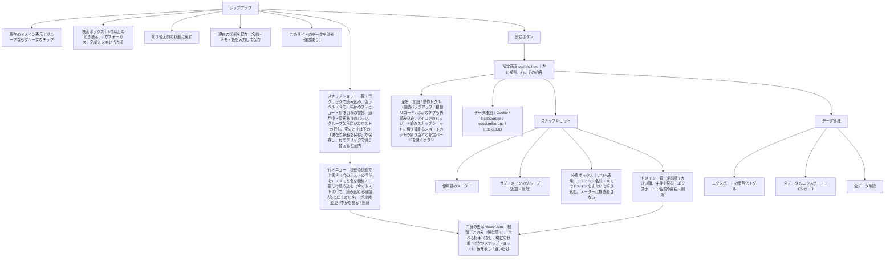

# tk3-switch-browser-data-extension

Chrome / Edge 向けブラウザ拡張機能。ドメインごとに Cookie・localStorage・sessionStorage・IndexedDB を保存し、名前付きスナップショットとして切り替えられる。

## 概要

- **対応ブラウザ**: Chrome, Edge (Chromium ベース・Manifest V3)
- **UI 起点**: 拡張機能アイコンをクリックして開くポップアップと、前のスナップショットに切り替えるキーボードショートカット（右クリックメニューは使わない）
- **設定画面**: ポップアップ内の設定ボタンまたは `options.html` で開く

## 機能要件

### データ種別（ドメインごとに管理）

| 種別           | API                                                                      |
| -------------- | ------------------------------------------------------------------------ |
| Cookie         | `chrome.cookies` API                                                     |
| localStorage   | コンテンツスクリプト（`content/content-script.js`）が `window.localStorage` を読み書きし、ポップアップとは `chrome.tabs.sendMessage` でやり取りする |
| sessionStorage | 同上（`window.sessionStorage`）                                          |
| IndexedDB      | 同上（`indexedDB` を JSON にシリアライズ / リストア）                    |

### スナップショット操作

- **保存**: 「現在の状態を保存」から名前を入力して保存する。既存の名前なら上書き確認後に上書き。各行のメニューの「現在の状態で上書き」でも上書きできる
  - 保存フォームでメモ（1行・100文字まで）と色ラベル（赤・橙・緑・青の4色。明暗の両方に値がある `--tk-*` の色だけ）を付けられる。行メニューの「メモと色を編集」で後から変える。上書きしてもメモと色は引き継ぐ。書き込むときはいつも `cleanDetails`（`lib/snapshot-summary.js`）を通し、改行は空白に、100文字を超える分は切り、一覧にない色は捨てる（インポートも同じ）
  - 色ラベルは名前の前の小さなチップ。行頭の点は「適用中・変更あり」を表すので、色ラベルには使わない
  - 「一部適用中」のスナップショット（「適用中の表示」を参照）を上書きするとき（行メニュー・「変更あり」のメニュー・保存フォームで同じ名前のどれでも）は、記録した種類のうち設定で有効なものだけをページから集めて置き換え、ほかの種類は保存したまま残す（`cookies` は `cookieDomain` と、`indexedDB` は `indexedDBDigest` と一緒に置き換える。集められなかった種類も保存したままで、その種類の「変更あり」は消さず、ステータスに保存した種類を出す（`status_saved_partial`）。どの種類も集められなかったとき（Cookie の権限がない、ページに届かないなど）や、確認のあとにスナップショットが消えていたときは保存せずにエラーにし、「変更あり」も消さない。保存したデータの読み直しと書き戻しは `replaceSnapshotFields`（`lib/snapshot.js`）が `withSnapshotLock` の中で行う）。記録は同じ種類のまま「一部適用中」に残す（読み込んでいない種類は別のアカウントのものかもしれず、それをスナップショットに書かないため）。確認ダイアログには置き換える種類を出す（`confirm_overwrite_partial`）。記録した種類がどれも設定でオフなら、確認を出さずにエラーを表示して上書きしない。全部を保存したいときは新しい名前で保存するか、先に丸ごと読み込む。ほかの名前の保存・上書きはこれまでどおり有効な種類をすべて保存し、記録は丸ごとになる
- **中身のプレビュー**: 各行にメモと `Cookie 12 · LS 4 · SS 1 · IDB 2 · 34.0 KB` のような件数と大きさを出す（`summarize`）。0件の種類は `LS 0` と出し、スナップショットにない種類は出さない。保存した Cookie に期限切れのものが1件でもあれば、控えめな警告アイコンを出す（ログインが切れているかもしれない、という知らせで、読み込みは止めない）。検索はメモにも当たる
- **読み込み**: 一覧の行をクリック（または数字キー・`Enter`）→ 現在のデータをそのスナップショットに丸ごと置き換え
  - 自動バックアップが有効なら、読み込む直前の状態をドメインごとに1件だけ残し、確認なしで読み込む（「戻す」で復元。戻すと置き換えた状態が新しいバックアップになるので、もう一度押すと元に戻る）。無効なら読み込み前に確認する
  - 自動リロードが有効なら、読み込み後にタブを再読み込みする。再読み込みの前に今のタブが閉じられていても、データはもう書き換えたので、`console.error` に出すだけで完了の表示とほかのタブの再読み込みは続ける
  - **一部だけ読み込む**: 行メニューの「一部だけ読み込む…」で、読み込む種類を選んで読み込む（`handleLoadPartial` → `loadEntry`）。出すのは今のホストの行で、読み込める種類（設定で有効で、スナップショットにある種類。`loadableTypes`）が2つ以上のときだけ。選ばなかった種類のページのデータには触らない
    - 選ぶダイアログ（`popup/type-picker.js`）には読み込める種類だけを並べ、Cookie があれば Cookie だけに最初からチェックを入れる。1つも選ばないと読み込まない。自動バックアップが無効なら、選んだ種類の今のデータは上書きされ元に戻せない旨をダイアログの中に出す（確認のダイアログは重ねない）。選んだ内容は覚えない
    - バックアップは丸ごとの読み込みと同じく、有効な種類をすべて残す
    - Cookie を選ばないときは、バックアップを残す前にコンテンツスクリプトに届くか確かめ（`canReachPage`）、届かなければ何も残さず書かずにエラーにする（丸ごとの読み込みにはこの確認はない）
    - 適用中に記録するのは実際に書いた種類だけ。Cookie は `applyData` の `cookiesApplied`、ページの保存領域はコンテンツスクリプトが書き込みの成功を返したとき（`storageApplied`）。どれも書けなかったときは記録せずエラーにする。ステータスには書いた種類を出す
    - Cookie の確認待ちとほかのタブの再読み込みは、丸ごとの読み込みと同じく実際に書いたもので決まる（Cookie を選ばなければ確認待ちは始めない）
    - すべての種類を選んだときは丸ごとの読み込みと同じ（記録は丸ごと。届くかの確認はせず、ステータスも丸ごとの読み込みのもの）
    - 同じスナップショットの「一部適用中」にさらに一部を読み込んだときは、今回書かなかった記録済みの種類の「変更あり」をそのまま残す
  - **ほかのタブの再読み込み**（`settings.reloadOtherTabs`、既定はオフ。自動リロードがオンのときだけ効く）: 読み込み・「戻す」・サイトのデータの消去のあと、書き換えたデータを見ているほかのタブも再読み込みする（`otherSiteTabs`、`lib/site-tabs.js`）。対象は同じプロファイル・同じシークレットモードの `http(s)` のタブで、次のどちらかに当たるもの
    - Cookie を実際に書いたとき、そのタブのホストが書いた範囲に入る（`isWithin(ホスト, 範囲の domain)`。`exact` の範囲でも `.host` の Cookie はサブドメインに届くのでサブドメインを含む。スキームとポートは問わない）。書いたかは `applyData` の `cookiesApplied`、消去では `clearData` の `beforeCookies` に渡る範囲で決める
    - localStorage か IndexedDB を実際に書いたとき、今のタブと同じオリジン（`applyData` の `sharedStorageApplied`。消去では localStorage か IndexedDB が有効なとき）。sessionStorage はタブごとでほかのタブに届かないので、sessionStorage だけを書いた・消したときは同じオリジンのタブを再読み込みしない
    - 破棄されたタブ（`discarded`・`status: 'unloaded'`）は選ばない（開いたときに新しいデータで読み込むため）
  - 読み込み・「戻す」で Cookie の確認待ちを始めたときは、ほかのタブの ID を確認待ちに `reloadTabs` として残し、ポップアップは今のタブだけを再読み込みする。Service Worker が今のタブの確認待ちを受け取って学習してから `reloadTabs` を再読み込みする（同時に読み込むと、ほかのタブが sessionStorage に残る前のアカウントの Cookie を書き戻し、それを「サイトが自分で書き換えた」と覚えてしまうため）。確認待ちが期限切れ・権限なしで学習できなくても `reloadTabs` は再読み込みする。`reloadTabs` には各タブの ID と選んだときのオリジンを `{ id, origin }` で残し（`tabsToReload`）、Service Worker は再読み込みの直前に `chrome.tabs.get` で確かめ直して、破棄された（`discarded`・`status: 'unloaded'`）タブ、`http(s)` でなくなったタブ、オリジンが変わったタブは再読み込みしない（`reloadTabsStillOn`。選んでから今のタブの読み込みが終わるまでに、ほかのサイトに移ったり破棄されたりしていることがあるため。期限切れの確認待ちでも同じ）。オリジンのない古い形（ID だけ）の項目は `takeCookieCheck` が捨てる。確認待ちのない場合（消去、Cookie を書かなかった読み込み・「戻す」）はポップアップが今のタブ、ほかのタブの順に再読み込みする
  - ステータスには、再読み込みしたほかのタブの数を「（ほかの 2 タブも再読み込み）」と添える（Service Worker に任せたときは任せた数）。0 なら何も添えない
  - 再読み込みしても切り替わらないもの: ほかのタブの sessionStorage（タブごとで再読み込みでも残るので、そこにログイン情報を置くサイトではほかのタブは前のアカウントのまま。設定画面のトグルの下に注意書きを出す）、グループのほかのホストのページの保存領域、Service Worker や Cache API の中身、選ばなかった破棄済みのタブ（次に読み込むまで）。今のタブが閉じられた・読み込みが終わらない・範囲の重なる読み込みで確認待ちが置き換わった・全データ削除で `cookieChecks` が空になった、のときは後からの再読み込みは起きない
  - 今のタブもほかのタブも、そのタブの URL に `chrome.tabs.update` で移って読み直す（今のタブは `reloadTab`、ほかのタブは `reloadTabs`。どちらも直前に `chrome.tabs.get` で今の URL を読み直す）。`chrome.tabs.reload` は、フォームの POST の結果を出しているタブでは確認なしにフォームを送り直し、切り替えたあとのアカウントで送ってしまうため。URL に `#` があるタブだけは、同じ URL に移ってもページ内の移動になって読み直されないので `chrome.tabs.reload` を使う（`#` 付きの URL が POST の結果であることはまれ）。POST の結果のページは同じ URL を GET で開き直すので、POST でしか受けない URL ではエラー（405 など）や空のフォームの画面になる（送り直すよりはよいとして受け入れている）。POST を送り直さないことは E2E で、今のタブを自動リロードする場合とポップアップがほかのタブを再読み込みする場合（`tests/e2e/popup.spec.js`）、Service Worker が確認待ちのあとで再読み込みする場合（`tests/e2e/cookies.spec.js`）を確かめる。同じ URL への移動でも読み込みの完了（`status: 'complete'`）は届くので、Service Worker の Cookie の学習はそのまま働く。同じ URL への移動は `chrome.tabs.reload` と同じくサーバーに問い合わせ直すので、キャッシュできるページでもページの HTML はキャッシュから出さない（`tests/e2e/popup.spec.js` で確かめる）
- **適用中の表示**: 最後に読み込み・保存したスナップショットをドメインごとに記録し、一覧に「適用中」、拡張機能アイコンのバッジに名前の先頭2文字を表示する。ポップアップを開いたときに今のデータと比べ、違えば「変更あり」を表示し、何が変わったかをツールチップに出す
  - 一部だけ読み込んだときは、読み込んだ種類を記録に残し（`types`）、行に「適用中」の代わりに「一部適用中」を出してツールチップに記録した種類を出す。比べるのは記録した種類のうち設定で有効なものだけ（`comparedTypes`。どれも有効でなければ何も比べない。あとから設定でオフにした種類も記録には残す）
    - 同じスナップショットが「一部適用中」のときにさらに一部を読み込むと、記録は前の種類と今回書いた種類を合わせたものになり、読み込める種類をすべて覆えば丸ごとの記録に戻る。丸ごと適用中のスナップショットやほかのスナップショットが適用中のときは、今回書いた種類だけに置き換える
    - 丸ごとの読み込み、ほかの名前の保存・上書きで記録は丸ごとになる。「一部適用中」のスナップショット自身の上書きでは一部のまま（「保存」を参照）
    - 拡張機能アイコンのバッジは一部の記録でも区別せず、名前の先頭2文字を出す
  - 適用中の記録があるスナップショット X から別のスナップショット Y（ホストか名前が違う）に記録が変わったときだけ、X を「前のスナップショット」として `previousSnapshots` に `{ host, name }` で残す（`types` は残さないので、ショートカットではいつも丸ごと読み込む）。ほかの変わり方（記録を外す、記録のない状態から Y、`types` だけの変化、同じスナップショットの読み直し）では前の記録をそのままにする（消去してから「戻す」で、消したスナップショットを前の記録にしないため）。記録は `setActiveSnapshot`（`lib/snapshot.js`）が `withSnapshotLock` の中で適用中の記録と1回の `set` で書くので、読み込み・ほかの名前の保存・「戻す」・ショートカットのどれでも同じ決まりで残る。名前の変更・削除では適用中の記録と同じく書き換える・外す
  - Cookie は値まで比べる。ただしサイトが自分で書き換える Cookie は除く。読み込み後の最初のページ読み込み（60秒以内）で、Service Worker が適用した Cookie と比べて値が変わったものを「値は比べない」、増減したものを「比べない」としてドメインごとに覚える（`volatileCookies`）
  - スナップショットに保存した Cookie がすでに有効期限切れなら、その Cookie は比べない（発行し直されるか消えているのが当然のため）
  - 「変更あり」のバッジはメニューを開くボタンで、変わった Cookie ごとに「変化を無視」を選べる。値の変化なら「値は比べない」、増減なら「比べない」として `volatileCookies` に記録する。今のホストの行では、メニューの「現在の状態で上書き」でそのスナップショットを上書きすることもできる（上書きすると「変更あり」は消える）
  - IndexedDB はページ側（コンテンツスクリプト）で中身のハッシュ（`lib/storage-digest.js`）だけを計算して受け渡す。スナップショット側のハッシュは保存時に `indexedDBDigest` として一緒に残す
  - アイコンのバッジの地の色は、適用中のスナップショットの色ラベルに合わせる（`badgeColors`、`lib/badge.js`）。タブごとに文字と一緒に描き、色ラベルのないタブには既定の色を明示して渡す（前に色を付けたタブを戻すため）。「変更あり」はバッジに出さない

    | 色ラベル | 地 | 文字 |
    | --- | --- | --- |
    | なし・青 | `#1F63D8`（`--tk-blue`） | `#FFFFFF` |
    | 緑 | `#1E7E45`（`--tk-green`） | `#FFFFFF` |
    | 赤 | `#C5221F`（`--tk-red`） | `#FFFFFF` |
    | 橙 | `#F6B820`（`--tk-icon-yellow`） | `#1B1C20`（`--tk-ink`） |

    - 青は色ラベルなしと同じ色（既定を変えると今あるバッジがすべて変わるため）
    - 橙だけ `--tk-amber`（`#9A5200`）を使わない。白い文字とのコントラストは足りるが、明るさが赤とほぼ同じで、バッジの大きさでは赤と見分けられないため。そのため明るいモードのポップアップの色ラベル（茶）とは色が違う
    - ツールバーのテーマは読めないので、明暗で同じ色を使う。明るいツールバーでは黄色のバッジの縁が地と約 1.8:1 しか差がないが、文字は 9.6:1 あり色相で見分けられるので受け入れている（暗い橙にすると赤に近づく）
    - 色は取れたら付ける程度のもので、文字は色を待たない。色を読めなかったタブは既定の色で描き、次に描くときに読み直す
    - 色を読んでいる間にタブがほかのサイトに移ったら、古い描画は捨てる（タブごとに最後に始めた描画だけを反映する）
    - 色を読んでいる間にそのホストのスナップショットが書き換わったら、読んだ結果の代わりに変更の新しい値から色を取り、待っている描画はそれで描く（色ラベルが変わらない保存で全タブを描き直さないため）
- **ショートカットで前のスナップショットに切り替え**: `commands` の `switch-previous` を押すと、ポップアップを開かずに Service Worker（`background/switch-command.js`）が、今のタブのサイトの「前のスナップショット」（`previousSnapshots`）を丸ごと読み込む。もう一度押すと元のスナップショットに戻るので、2つのアカウントを1つのキーで行き来できる
  - キーは既定で割り当てない（`suggested_key` なし。確認なしでサイトのデータを書き換えるので使う人が選ぶ。ぶつかる提案のキーは Chrome が黙って捨て、どのキーも Chrome・Edge・ほかの拡張機能のどこかと重なるため）。設定画面の「全般」に今の割り当て（`chrome.commands.getAll()`、なければ「未設定」）と、`chrome://extensions/shortcuts` を開くボタンを出し、ウィンドウの `focus` で読み直す（`options/shortcut-hint.js`）
  - 対象のタブは `onCommand` が渡すタブで、渡されないときだけ `chrome.tabs.query({ active: true, lastFocusedWindow: true })` の最初のもの。リスナーは Service Worker の読み込みで待たずに登録する（コマンドで起きた Worker が取りこぼさないため）
  - 読み込みは `loadWholeSnapshot`（`lib/load-snapshot.js`）で、ポップアップの `state` を使わず、権限のダイアログも出さない（`collectData` `applyData` に `interactive: false`）。バックアップを残し、ページの保存領域、Cookie の順に適用し（サイトのデータの消去と同じく、ページが断ったときに Cookie、つまりログイン中のアカウントを変えないため。ポップアップの読み込みは Cookie が先のまま）、適用中に記録し（グループなら `{ host, name }`）、Cookie の確認待ち・今のタブとほかのタブの再読み込みはポップアップの丸ごとの読み込みと同じ（どちらも `reloadAfterApply`（`lib/tab-reload.js`）を通す）。ポップアップの読み込み（`popup/actions.js`）はこれを使わない（一部だけ読み込む処理と `state` に結びついているため）
  - 失敗はタブのバッジの `!`（ふだんのバッジの色で、4秒後にタブを `chrome.tabs.get` で読み直して、今のサイトのバッジ（文字と色）を描き直す。閉じたタブは描かない。4秒の間は、適用中の記録の変化やタブの読み込みで始まるバッジの描き直しがそのタブを飛ばす（`isFlashing`。切り替えそのものが記録を変えて再読み込みするので、すぐに消えてしまうため））、`commandNotice` に残す知らせ、`chrome.action.openPopup()` で伝える。`openPopup` がない（Chrome 127 より前）・断られる（ウィンドウにフォーカスがない）ときは `!` と知らせだけで、知らせは60秒の間そのタブで同じホストのままポップアップを開いたときに出る。上から順に確かめる

    | 場合 | 動き |
    | --- | --- |
    | ポップアップが開いている（`chrome.runtime.getContexts({ contextTypes: ['POPUP'] })` が1つ以上）、または `getContexts` がない（Chrome 116 より前） | 切り替えない。`!` だけで、知らせも `openPopup` もない（開いたポップアップの表示が古くなるため。数えるのはポップアップだけで、設定画面のタブや Worker は数えない） |
    | `http(s)` でないページ | 何も書かない。知らせ `unavailable` |
    | Cookie が有効でホスト権限がない | 何も書かない。知らせはなく、ポップアップが権限の案内を出す（Service Worker は権限を求めない） |
    | 自動バックアップが無効 | 切り替えない。知らせ `shortcut_needs_backup`（ポップアップはこのとき確認を出すので、1回のキーで確認なしに戻せない上書きをしない） |
    | 前の記録がない、適用中と同じ、そのスナップショットがもうない、グループを外したなどで今の範囲の外のホストを指す | 何も書かない。知らせ `shortcut_no_previous` |
    | 前のスナップショットが今のホストのもので、書き込むページの保存領域（設定で有効で、スナップショットにある種類）があるのにコンテンツスクリプトに届かない（`canReachPage`） | バックアップも残さず何も書かない。知らせ `shortcut_page_unreachable`（Cookie だけのときは確かめない） |
    | バックアップのために今のデータを読めなかった（書き込むページの保存領域があるのにコンテンツスクリプトがエラーを返す・答えない・その種類を返さない、または書き込む Cookie があるのに Cookie を読めない） | バックアップも残さず何も書かない。知らせ `error_load_failed`（`collectData` の `strict: true`。1回のキーで戻せない上書きをしないため。Cookie だけを書くときはページを読めなくても止めない） |
    | 書き込むページの保存領域があるのに、ページへの書き込みが届かない・成功を返さない（`applyData` の `storageApplied` が偽） | Cookie を書かず、適用中の記録も前の記録も変えずに止める。ページの保存領域は、残したばかりのバックアップから書き戻してみる（途中まで書いたものを戻すため。ページが受け取らなければそのまま）。知らせ `error_load_failed` |
    | ページを書いたあとで Cookie の書き込みが失敗した（`setCookiesForDomain` が例外を投げた） | 適用中の記録も前の記録も変えずに止める。ページの保存領域と Cookie を、残したばかりのバックアップから書き戻してみる。知らせ `error_load_failed` |
    | 切り替えの途中でタブがほかのオリジンに移った | 次のオリジンの確認か、コンテンツスクリプトが断ったところで止める。知らせ `error_load_failed` |
    | バックアップを書けなかった | 何も適用せずに止める。知らせ `shortcut_backup_failed`（ポップアップと違い、戻せない状態では切り替えない） |
    | 前のスナップショットがグループのほかのホストのもの | 行のクリックと同じく Cookie だけを適用し、ページへの書き込みは送らない |
    | 「一部適用中」から押した | 前のスナップショットを丸ごと読み込む。一部だったものは `types` のない前の記録になり、もう一度押すと丸ごと読み込む |
    | 適用中の記録がない（消去のあと、名前のない状態に「戻す」したあと） | 前のスナップショットを読み込む。適用中と前の記録が同じになるので、次に押すと `shortcut_no_previous` |
    | キーの長押し（切り替えの途中にもう一度届いた） | 無視する（フラグは `finally` で外す） |

  - オリジンは2か所で確かめる。Service Worker は今のデータを読む前・バックアップを書く前・適用する前に `chrome.tabs.get` でタブを読み直し、オリジン（パスは問わない）が変わっていれば止める（`stillOnOrigin`）。コンテンツスクリプトは `getStorageData` `setStorageData` のメッセージに `origin` があり `location.origin` と違えば `{ error }` を返して読み書きしない（最後の確認からページに書くまでの間に移ったときも、ほかのサイトにデータを書かないため）。`origin` を送るのはショートカットだけで、ポップアップのメッセージにはない（ないときはこれまでどおり）。ページが断ったときは Cookie を書く前に止まるので、ログイン中のアカウントは変わらない
  - 成功はふだんのバッジの描き直しと再読み込みでわかる。バッジがオフのときは、切り替えたスナップショットの名前の先頭2文字を、失敗の `!` と同じく4秒だけ出す（自動リロードもオフだと何も出ないため）
  - ポップアップは開くとき（`init` で今のタブがわかった直後、使えないページ・権限の案内より前）に `commandNotice` を読み（`popup/command-notice.js`）、期限切れかこのタブの知らせなら消し、このタブで期限内で、キーが決めた一覧（`shortcut_*` の4つ・`unavailable`・`error_load_failed`）にあり、知らせの `host`（押したときのタブの `http(s)` のホスト名。`http(s)` でなければ `null`）が今のタブのものと同じときだけ `#statusMsg` にエラーとして出す（同じタブがほかのサイトに移ったあとで、前のサイトのエラーを今のサイトのものに見せないため。ホストが違う知らせは出さずに消す）。ほかのタブの期限内の知らせは残す。知らせにはメッセージのキーとホストだけを残し、スナップショットの名前は入れない
  - `migrateStorage()` は呼ばない（前の記録はこの版のポップアップが動いたあとにしかできず、古い形にしかないスナップショットは「前のスナップショットがない」になる）
- **名前の変更・削除**: 各行のメニューから行う（削除は確認あり）
- **中身の表示と比較**: ポップアップの行メニューの「中身を見る」（グループのほかのホストの行にも出す）か、設定画面のスナップショットの行のボタンで、`viewer/viewer.html?host=<ホスト>&name=<名前>[&tab=<タブ ID>]` を新しいタブで開く（`openViewer`、`lib/viewer-link.js`。`tab` はポップアップから開いたときの今のタブ）。保存したものを種類ごとの表（Cookie / localStorage / sessionStorage / IndexedDB はデータベースとストアごとに `version` `keyPath` `autoIncrement` を添える）で見せる。スナップショットにない種類は出さない。ホストか名前がない、または読んだデータに自分のプロパティとしてない（`__proto__` など）ときは「見つかりません」を出す
  - 値はすべての種類で既定で隠し、`••••••` と文字数だけを出す（隠している間は値を DOM のテキストにも属性にも置かない）。セルをクリックするとそのセルだけ、「値を表示」のトグルですべてを出す。覚えておくのはトグルだけで、表を描き直すとクリックで出した値は隠れ、トグルをオフにするとすべて隠す。トグルも保存せず、開くたびにオフ（保存すると書き込みになるため）。Cookie の名前・ドメイン・パス、ストレージのキー、比べた結果の印は隠さない（ただし IndexedDB の `keyPath` に `''` を含むストアはキーがレコードそのものなので、キーも値と同じように隠す）。長い値は 200 文字までを出し、「全体を表示」でも 100,000 文字まで
  - 表は `<details>` を初めて開いたときに描き、200 行ずつ「さらに表示」で足す（「違いだけ」で絞ったあとに数える）
  - 比べる相手は「なし」「現在の状態」と、同じホストのほかのスナップショット（並び順のとおり）。違いは行ごとに追加 `+`・削除 `−`・変更 `~` で示し、種類ごとに件数を出す（「違いだけ」は比べている間だけ出し、既定はオン）。突き合わせは `lib/snapshot-diff.js` で、Cookie は `cookieKey` で値と `secure` `httpOnly` `sameSite` を比べ（有効期限は更新のたびに変わるので比べない）、Web Storage はキー、IndexedDB は `keyPath` の値で突き合わせる。`keyPath` のない（文字列か文字列の配列でないものを含む）ストアやキーのないレコードは中身の一致だけを見て、追加と削除だけを出す。ストアの構成の違いはストアの見出しに出し、片方にしかないデータベース・ストアは見出しに「追加」「削除」を出す（空のものでもわかるように）。片方にない種類は「比べられません」と理由を出す（空の種類は比べて、すべて削除になる）
  - Cookie には2つの範囲がある。**読み込む範囲**は見ているスナップショットの `cookieDomainFor` で、読み込んだときに書き戻す範囲。その外の Cookie（と `cookiesWithin` が捨てる Cookie）には、比べるかどうかにかかわらず「読み込まない」を付ける。**比べる範囲**は、現在の状態となら読み込む範囲、ほかのスナップショットとなら2つの読み込む範囲のうち内側のほう（`narrowerScope`）で、両方をこの範囲に絞ってから突き合わせる。比べる範囲に入るかは Cookie の `domain` だけで決める（形の崩れた Cookie も範囲内なら比べ、「読み込まない」を付ける）。見ているスナップショットの範囲外の Cookie は「範囲外」として件数に数えず「違いだけ」で隠し、相手の範囲外の Cookie は行にしない。範囲と、範囲外になった件数を注記に出す。どちらの範囲もほかの内側にないときは Cookie を比べない（範囲を推測しない）。「期限切れ」「自動で変わる」（`volatileCookies` にあるもの）の印も付ける（ポップアップの「変更あり」で比べないもの）
  - 現在の状態は選んだときだけ読む。ページのデータはホスト名がちょうど同じ（サブドメインは含まない）`http(s)` のタブで、破棄されておらず、ビューアーと同じシークレットモードのものから読み、`tab` のタブが当てはまればそれを先に使う。読んだタブのオリジンを注記に出す。読んだあとで `chrome.tabs.get` でそのタブが今も同じオリジンにあるか確かめ直し、ほかのサイトに移っていればページのデータを捨てて「読めませんでした」にする（ほかのサイトのデータをこのホストのものとして出さないため）。IndexedDB は Web Storage と別に読む（大きすぎて渡せなくても Web Storage の比較を失わないため）。タブがない・読めない種類は「比べられません」と、何をすればよいかを出す（`file:` のページのスナップショットはホストがなくタブを選べないので、ページのデータは比べられない旨を出す）。ビューアーはいつも通常のプロファイルで開くので、`tab` のタブがシークレットウィンドウなら（どのホストでも）現在の状態は Cookie も含めて何も読まない（ほかのセッションのデータと比べてしまうため）
  - ホスト権限はビューアーからは求めず（`interactive: false`）、Cookie の比較だけを止めてポップアップで許可するよう案内する。ページのデータはポップアップと同じくコンテンツスクリプトから読み、ホスト権限を要しない
  - 見るだけで書き込まない（`chrome.storage`・Cookie・ページのどれにも書かない。ページに送るのは `getStorageData` だけ）。`migrateStorage` も呼ばない（開く前にポップアップか設定画面がすでに呼んでいる）。`storage.onChanged` も聞かず、新しい内容はタブの再読み込みで見る。開く処理が失敗したときは空白にせず、開けなかった旨を出す。グループのほかのホストのスナップショットとは比べない
- **サイトのデータの消去**: ポップアップの「このサイトのデータを消去」で、設定のデータ種別トグルで有効な種類（Cookie / localStorage / sessionStorage / IndexedDB）を確認後に消す。自動バックアップが有効なら消す前の状態を残し（「戻す」で復元）、適用中の記録を外し、自動リロードの設定に従って再読み込みする。IndexedDB はデータベースごと削除する（ページが接続を開いたままなら削除は予約され、再読み込みで完了する。自動リロードがオフならその旨を表示する）。ほかのタブの再読み込みがオンなら、同じサイトのほかのタブも再読み込みする（「読み込み」の「ほかのタブの再読み込み」を参照。ほかの同じオリジンのタブが開いたままの IndexedDB の削除もそこで終わる）
  - 消す前にコンテンツスクリプトに届くか確かめ（`ping`）、届かなければ何も消さず、バックアップも上書きしない。消す順番はページの保存領域が先で Cookie が後（途中で失敗しても Cookie だけ消えた状態にしない）
  - 読み込み直後の Cookie の確認待ち（`cookieChecks`）は消去時に、同じ Cookie の範囲を見ているすべてのタブの分を取り消す（空になった Cookie を「サイトが自分で消した」と覚えないため）。読み込みで新しく確認待ちを始めるときも、範囲の重なるほかのタブの確認待ちは捨てる。重なりは各確認待ちの `cookieDomain` と `cookieExact` で決める（`exact` の範囲はそのホストの Cookie だけなので、兄弟のホストやサブドメインとは重ならない）。取り消すのは Cookie を消す直前（`clearData` の `beforeCookies`）なので、Cookie を消さない設定や、その前に失敗したときは確認待ちを残す
  - グループに入るサイトでは、グループの Cookie（`.example.com` と各サブドメインのもの）をまとめて消し、ページの保存領域は今のページの分だけ消す。グループに入らないサイトでは親ドメイン（例: `app.example.com` に対する `.example.com`）の Cookie は消えない（そのサイトのホスト権限ではその Cookie を読めないため。まとめて扱いたいときは設定画面でグループにする）
- **サイトへのアクセスの許可**: Cookie の読み書きにはサイトごとのホスト権限（`optional_host_permissions`）が要る。Chrome は権限のダイアログを出すとポップアップを閉じてしまい、保存・読み込みの途中で求めるとその操作が知らせなく失われる。そのため、Cookie が有効で権限がまだないときは、ポップアップを開いた時点で一覧の代わりに「アクセスを許可」の案内を出し、許可したらもう一度開くよう伝える。Cookie を使わない人向けに設定画面への導線も置く

### ドメイン管理

- ポップアップはアクティブタブの URL からドメインを自動検出して表示
- 設定画面でドメインの追加・削除・一覧管理が可能
- 保存データはドメインをキーとして `chrome.storage.local` に永続化

### サブドメインのグループ

- 設定画面の「スナップショット」でベースのドメイン（例: `example.com`）をグループにすると、`example.com` と `*.example.com` の Cookie（`.example.com` のドメイン Cookie を含む）をまとめて保存・消去・読み込みする。ホスト権限は `*://example.com/*` と `*://*.example.com/*` の2つ
- 追加するときは `validateNewGroup`（`lib/groups.js`）で、ドットのない名前・IP アドレス・既存のグループと重なるもの・`co.jp` のような区分（`BROAD_SECOND_LABELS`）・`github.io` のような共有ホスティング（`SHARED_HOST_SUFFIXES`）を断る。一覧は完全にはならないので、確認ダイアログでは毎回、まとめる範囲（`example.com` と `*.example.com`）と「無関係なサイトが共有するドメインには使わない」旨を出す。削除するときは `*://*.example.com/*` の権限だけ外す
- **グループは保存したデータを動かさない**。スナップショット・並び順・バックアップは保存したホストのキーのまま残り、グループを作っても消してもインポートしても書き換えない。グループはホストをまたいだ「見え方」と Cookie の範囲にすぎない（動かすと、作成・削除・インポートのたびに並び順・適用中・バックアップ・Cookie の扱いを決める必要があり、届かなくなるスナップショットや壊す操作が生まれたため）
  - ポップアップは、グループに入るホスト（`memberHosts`）のスナップショットを並べる（今のホストが先、ほかはホスト名順、それぞれ保存した順）。行はホストと名前で区別し、ほかのホストの行にはホスト名を出し、「現在の状態で上書き」は出さない（今のページのデータをほかのホストのキーに書いてしまうため）。新しく保存するのはいつも今のホスト
  - ページの保存領域（localStorage・sessionStorage・IndexedDB）は、スナップショットを保存したホストと今のホストが同じときだけ書き戻す。違えば Cookie だけ適用して、その旨を表示する
  - グループで保存したスナップショットには集めた Cookie の範囲を `cookieDomain` として残す（ないときは保存したホストの Cookie だけ。`host` と `.host` で、サブドメインは含まない）。読み込み・比較・プレビューでは `cookieDomainFor` でその範囲と今の範囲の狭いほうに絞り、`{ domain, exact }` で返す（`exact: true` はそのホストの Cookie だけ）。グループを作る前に保存したスナップショットは、ベースのホスト（`example.com`）で保存したものも含めてそのホストの Cookie だけを書き換え、ほかのサブドメインの Cookie は残す。グループを消したあとは、グループで保存したスナップショットもそのホストの範囲だけを扱う。`cookieDomain` が今の範囲と重ならないとき（細工したファイルなど）は、保存したホストの範囲に落とす
  - Cookie を書き戻すときは `setCookiesForDomain` が範囲の外の Cookie を捨て（インポートしたデータも含めて1か所で守る）、`.` で始まる Cookie は `domain` を付けてドメイン Cookie として戻す（グループでなくても同じ）。`domain` がホスト名の形でないもの（`evil.com#.example.com` など。角かっこの IPv6 アドレス `[::1]` は通す）や、組み立てた URL のホストが `domain` と食い違うものも捨てる
  - グループに入らないサイトの消去も、そのホストの Cookie（`host` と `.host`）だけを消す
  - 適用中の記録・`volatileCookies`・`cookieChecks` の `domain` はグループのベースをキーにする（Cookie はグループで共有なので、適用中のスナップショットはグループで1つ）

### 設定画面

- 左に項目（全般 / データ種別 / スナップショット / データ管理）、右にその項目だけを出す2列。`location.hash`（`#general` `#data-types` `#snapshots` `#data`）で開く項目を選び、リンクに `aria-current` を付ける。720px より狭いと項目は上に横並び
- **使用量のメーター**（スナップショット）: `getBytesInUse(null)` の合計と、大きい順に5ドメイン・バックアップ・その他の積み上げ棒。ドメインの大きさは各スナップショットの `bytes`（`sizeOf`）の合計、バックアップは `backupHosts` に載る `backups/<ホスト>` のキーの `getBytesInUse` で、描くたびに読む。上限に対する割合の棒は出さない（`unlimitedStorage` で 10 MB の上限は外れているので、上限を描くと実在しない天井に見える。手を打てるのは「どのドメインが大きいか」）。50 MB 以上で「大きいとポップアップが遅くなる」と1行だけ知らせる。ポップアップが読むのは一覧に出すホスト（グループならその全ホスト）のキーと今のホストのバックアップだけだが、知らせの判定はいまも全体の `getBytesInUse(null)` で行う（大きさは容量ではなく速さに効く。50 MB は目安で `METER_ADVISORY_BYTES` の定数1つ）
- 並び順は「名前 / 大きい順」。大きい順のときは行のドラッグでの並べ替えをしない（見えていない順番を保存してしまうため）。行には色ラベル・メモ・大きさ・保存日時を出す（メモと色の編集はポップアップだけ）
- **検索**（スナップショット）: 並び順の上の検索ボックス（`#snapshotSearch`。件数にかかわらずいつも出し、`/` のショートカットはない）で、すべてのドメインをまたいで絞り込む。前後の空白を除き、大文字・小文字を区別せずに含むかで決める（`searchQuery` `matchesQuery`、`lib/snapshot-view.js`。ポップアップの検索と同じ決め方）
  - ドメイン名に当たればそのドメインの行をすべて、当たらなければ名前かメモに当たる行だけを出し、1行も当たらないドメインは出さない。出したドメインは開いた状態にし、件数は出した行の数（大きさはドメイン全体のまま）。大きい順の並びはそのまま効く
  - 絞り込んでいる間は、ドメイン名に当たって全行を出していても行のドラッグでの並べ替えをしない（大きい順と同じ理由）
  - スナップショットが1つもなければいつもの空の表示、あるのに何も当たらなければ「一致するスナップショットはありません」（`no_match`）
  - 入力のたびに覚えておいた内容から一覧だけを作り直す（`renderDomainList(groups, { meter: false })`）。読むのは `groups` だけで、スナップショットのキーも `getBytesInUse` も読まず、使用量のメーターは描き直さない。検索語は `renderDomainList` の await のあとで読む（メーターで止まっていた描き直しが、その間に打った検索語で描くため）。読み込みに失敗したら「スナップショットを検索できませんでした」（`error_search_failed`）を出し、一覧はそのまま
  - 名前を変えて当たらなくなった行や、削除で出している行がなくなったドメインの見出し（件数 0、大きさは隠れた行の分）は、次に描き直すまで残す（ドメインの最後の行を消したときの今の動きと同じ）
- **エクスポート**: 全データ・ドメインごと・スナップショットごと。暗号化しないファイルの形はいつも `{ ドメイン: { 名前: スナップショット } }`（古い版でも読める）。グループは書き出さない
- **暗号化**: 「データ管理」のトグル（`settings.encryptExports`、既定はオフ）をオンにすると、どのエクスポートでもパスフレーズを2回（8文字以上・一致）求める。オフのときはエクスポート後に「ファイルにログイン中のセッションが入っている」と知らせ、トグルを案内する。暗号化するのはエクスポートしたファイルだけで、`chrome.storage.local` は暗号化しない（鍵をデータの横に置くなら守りにならず、ブラウザを開くたびにパスフレーズを求めるとワンクリックで切り替えられなくなるため）
  - ファイルの形（`lib/crypto.js`）は最上位が配列の JSON: `["switch-browser-data-encrypted", { "version": 1, "kdf": "PBKDF2", "hash": "SHA-256", "iterations": 600000, "salt": "base64", "iv": "base64", "data": "base64" }]`。PBKDF2-SHA-256（60万回）で鍵を作り、AES-GCM-256（salt 16バイト、IV 12バイト）で暗号化する。暗号化より前の版はインポートで配列をすべて断るので、中身をドメインとして混ぜずに失敗する
  - 読み込めるのは `iterations` が 100,000〜1,000,000 のものだけ（細工したファイルで何秒も止めないため）。パスフレーズ違いは AES-GCM の検証の失敗でわかる。復号した中身がもう一度暗号化ファイルなら断る
- **インポート**: 256 MB（`IMPORT_MAX_BYTES`）を超えるファイルは読む前に断る。`parseImport`（`lib/transfer.js`）は形が `{ ドメイン: { 名前: オブジェクト } }` でない、`__proto__` `constructor` `prototype` のキーがある、`savedAt` が日時として読めない、`cookies` がオブジェクトの配列でない、ストレージの種類がオブジェクトでない、ドメインのキーが 253 文字を超えるか `a-z 0-9 . _ - [ ] :` 以外の文字を含む、ドメインが 5,000 個（`IMPORT_MAX_HOSTS`）を超える、のどれかでファイルごと断る（ドメインはそのまま保存のキーになり、本物のエクスポートには `URL.hostname` しか入らないため。`file:` のページから来る空のドメインは通す）。メモと色は `cleanDetails` で整え、文字列でない `cookieDomain` は捨てる。ファイルの `bytes` は使わず、いつも計算し直す（エクスポートでは `buildExport` が `bytes` を外すので、ファイルの形は変わらない）
  - 同じドメイン・同じ名前があれば、ファイル全体で1回だけ「上書き / スキップ / 両方残す（`名前 (2)` …）/ キャンセル」を選ぶ。上書きは並び順の位置を保ち、新しい名前は一覧に見えている順（並び順にない既存の名前も含む）の末尾に足す。ドメインのキーはファイルのまま書く
  - 同じ名前があるかの確認も混ぜる処理も、ファイルに出てくるホストのキーだけを読み書きする。書くのは中身が変わったホスト（`mergeImport` の `changedHosts`）だけで、そのキー・`snapshotHosts`・並び順を1回の `set`（`setSnapshotsAndOrders`）で書く（途中で失敗して一部のホストだけ取り込まれた状態にしないため）。選んだあとに保存データを読み直してから混ぜる（ダイアログを開いている間にポップアップで保存・変更したものを消さないため）。スナップショットを読んで書き戻す処理は、ポップアップ・設定画面のどちらからでも `withSnapshotLock`（`lib/snapshot.js`。Web Locks の `snapshots`。入れ子にはできない）で1つずつ行う
- 全データ削除は、すべてのキーを読んで `snapshots/` `backups/` で始まるキー・`snapshotHosts` `backupHosts`・古い形の `snapshots` `backups` と `commandNotice` を消し、並び順・適用中・前の記録（`previousSnapshots`）・`volatileCookies`・`cookieChecks` を空にする。`settings` `groups` `language` は残す（どれも設定のため）。`schemaVersion` も残す（形は変わらないため）。索引を当てにせず全部のキーを見るので、索引から漏れたキーも消える

### UI 構成



## ディレクトリ構成

```mermaid
graph TD
  root["tk3-switch-browser-data-extension/"]
  root --> CLAUDE["CLAUDE.md"]
  root --> manifest["manifest.json｜Manifest V3"]

  root --> popup["popup/"]
  popup --> popup_html["popup.html"]
  popup --> popup_css["popup.css"]
  popup --> popup_js["popup.js｜開くときの処理・権限の案内・イベントの登録"]
  popup --> popup_context["context.js｜ポップアップの状態と行の識別"]
  popup --> popup_list["list.js｜一覧の行・変更ありのメニュー・戻すバー"]
  popup --> popup_actions["actions.js｜再読み込み・変更の確認・各操作"]
  popup --> popup_save["save-form.js｜保存フォーム（名前・メモ・色）"]
  popup --> popup_picker["type-picker.js｜一部だけ読み込むときの種類の選択"]
  popup --> popup_notice["command-notice.js｜ショートカットの失敗の知らせの表示"]
  popup --> popup_keys["shortcuts.js｜キーボード操作"]

  root --> options["options/"]
  options --> options_html["options.html"]
  options --> options_css["options.css"]
  options --> options_js["options.js｜開くときの処理・項目の切り替え・トグル・言語・全データ削除"]
  options --> options_list["domain-list.js｜ドメイン一覧と行・並べ替え（読んだ内容を覚えておき、変更があったときだけ読み直す）"]
  options --> options_meter["meter.js｜使用量のメーター"]
  options --> options_shortcut["shortcut-hint.js｜ショートカットの割り当ての表示と設定ページへのボタン"]
  options --> options_groups["groups-pane.js｜グループの一覧・追加・削除"]
  options --> options_transfer["transfer-ui.js｜エクスポート・パスフレーズ・インポート"]

  root --> viewer["viewer/"]
  viewer --> viewer_html["viewer.html"]
  viewer --> viewer_css["viewer.css"]
  viewer --> viewer_js["viewer.js｜スナップショットの中身の表示・比べる相手の読み込み・値の表示の切り替え（見るだけ）"]

  root --> background["background/"]
  background --> sw["service-worker.js｜アイコンのバッジ更新・読み込み後の Cookie の学習とほかのタブの再読み込み"]
  background --> switch_cmd["switch-command.js｜前のスナップショットに切り替えるショートカット"]

  root --> content["content/"]
  content --> cs["content-script.js｜localStorage / sessionStorage / IndexedDB 操作"]

  root --> lib["lib/"]
  lib --> storage_js["storage.js｜chrome.storage.local ラッパー（キーと既定値の表、ホストごとのキーと索引）"]
  lib --> snapshot_js["snapshot.js｜スナップショット CRUD・保存データの形の変換（migrateStorage・SCHEMA_VERSION）"]
  lib --> domain_js["domain.js｜ホストが範囲に入るか（isWithin）・http(s) の URL の読み取り（parseHttpUrl）とホスト名（httpHostOf）・Cookie の範囲の正規化と包含（isScopeWithin）"]
  lib --> data_types_js["data-types.js｜データ種別の一覧（DATA_TYPES・PAGE_TYPES）と表示名・プレーンなオブジェクトの判定"]
  lib --> view_js["snapshot-view.js｜色ラベル・メモ・グループのチップの表示（ポップアップ・設定画面で共通）"]
  lib --> handlers_js["web-storage-handlers.js / indexeddb-handler.js｜ページの保存領域の読み書き（コンテンツスクリプトの非モジュール）"]
  lib --> cookie_js["cookie-handler.js｜Cookie 保存・復元"]
  lib --> bridge_js["data-bridge.js｜データの収集・適用"]
  lib --> load_js["load-snapshot.js｜ポップアップの状態を使わない丸ごとの読み込み（ショートカット用。バックアップとページの保存領域・Cookie の順の適用。再読み込みは tab-reload.js）"]
  lib --> compare_js["data-compare.js｜スナップショットと現在のデータの比較"]
  lib --> diff_js["snapshot-diff.js｜中身の表示の行と項目ごとの突き合わせ（読み込む範囲・比べる範囲）"]
  lib --> viewer_link_js["viewer-link.js｜中身の表示を開く URL の組み立てと新しいタブ"]
  lib --> menu_js["menu.js｜行メニュー（popover + focusgroup）"]
  lib --> rename_js["inline-rename.js｜その場での名前変更（ポップアップ・設定画面で共通）"]
  lib --> digest_js["storage-digest.js｜データのハッシュ（コンテンツスクリプトとポップアップで共通の非モジュール）"]
  lib --> volatile_js["volatile-cookies.js｜サイトが自分で書き換える Cookie の記録"]
  lib --> summary_js["snapshot-summary.js｜件数の集計、大きさ（bytes の記録と sizeOf）、メモと色の整形"]
  lib --> groups_js["groups.js｜サブドメインのグループと Cookie の範囲"]
  lib --> site_tabs_js["site-tabs.js｜書き換えたデータを見ているほかのタブの選択と再読み込み"]
  lib --> tab_reload_js["tab-reload.js｜書き込みのあとの Cookie の確認待ちと再読み込み（ポップアップ・ショートカットで共通の reloadAfterApply）"]
  lib --> transfer_js["transfer.js｜エクスポート・インポートの組み立てと検証"]
  lib --> crypto_js["crypto.js｜エクスポートファイルの暗号化（Web Crypto）"]
  lib --> etc_js["badge.js / time.js / dialog.js / i18n.js / ui.js"]
  lib --> tk_base["tk-base.css｜tk3 apps の共通デザインの土台（手を加えない）"]

  root --> icons["icons/"]
  icons --> isvg["icon.svg｜ヘッダー・favicon"]
  icons --> i16["icon16.png"]
  icons --> i32["icon32.png"]
  icons --> i48["icon48.png"]
  icons --> i128["icon128.png"]

  root --> tests["tests/"]
  tests --> unit["unit/｜Vitest ユニットテスト"]
  tests --> e2e["e2e/｜Playwright E2Eテスト"]
  tests --> support["support/｜chromeモック・テストヘルパー"]
  root --> pkg["package.json｜devDependencies（テストツールのみ）"]
```



## manifest.json の主要設定

```json
{
  "manifest_version": 3,
  "default_locale": "ja",
  "permissions": ["cookies", "storage", "unlimitedStorage", "tabs"],
  "optional_host_permissions": ["<all_urls>"],
  "background": { "service_worker": "background/service-worker.js", "type": "module" },
  "commands": {
    "_execute_action": { "suggested_key": { "default": "Alt+Shift+S" } },
    "switch-previous": { "description": "__MSG_command_switch_previous__" }
  },
  "action": { "default_popup": "popup/popup.html" },
  "options_page": "options/options.html",
  "content_scripts": [
    {
      "matches": ["<all_urls>"],
      "js": [
        "lib/web-storage-handlers.js",
        "lib/indexeddb-handler.js",
        "lib/storage-digest.js",
        "content/content-script.js"
      ],
      "run_at": "document_idle",
      "all_frames": false
    }
  ]
}
```

## データ構造（chrome.storage.local）

```js
{
  // スナップショットはホストごとのキー（"snapshots/" + ホスト）に { 名前: スナップショット } で置く。
  // file: のページではホストが空なので "snapshots/" というキーもありうる
  "snapshots/example.com": {
    "スナップショット名": {
      "savedAt": "ISO 8601 timestamp",
      "memo": "1行・100文字まで（任意）",
      "color": "red | amber | green | blue（任意）",
      // 集めた Cookie の範囲（グループで保存したときだけ。ないときはこのキーのホスト）
      "cookieDomain": "example.com",
      // このスナップショットの JSON（bytes 自身を除く）の UTF-8 のバイト数。保存・上書き・メモと色の編集・
      // インポート・移し替えのときに記録する。ないものは sizeOf がその場で計算する（書き戻さない）。エクスポートには含めない
      "bytes": 34816,
      "cookies": [ /* CookieDetails[] */ ],
      "localStorage": { "key": "value", ... },
      "sessionStorage": { "key": "value", ... },
      "indexedDB": { "dbName": { "storeName": [ /* records */ ] } }
    }
  },
  // キーのあるホストの一覧（索引）。manifest に minimum_chrome_version がないので getKeys() は使わない。
  // 値とその索引は1回の set で書き、空になったらキーを先に消してから索引を外す（途中で止まっても、
  // 索引にあってキーのないホストが残るだけで、読む側はそれを飛ばす）
  "snapshotHosts": ["example.com"],
  // 保存データの形のバージョン（lib/snapshot.js の SCHEMA_VERSION）。ないのは 2.0.0 より前の形で 1 とみなす。全データ削除でも消さない
  "schemaVersion": 2,
  "snapshotOrder": { "example.com": ["スナップショット名", ...] },
  // グループのベースでは、どのホストのスナップショットかも残す { host, name }
  // 一部だけ読み込んだときは、グループでなくても { host, name, types } にする（types は読み込んだ種類の名前
  // "cookies" "localStorage" "sessionStorage" "indexedDB" の配列）。読むときは知らない名前を捨て、配列でない・空になった
  // ものは types がないのと同じ（丸ごとの記録）とみなす。groups の削除でも types のある記録はそのまま残す
  "activeSnapshots": { "example.org": "スナップショット名", "example.com": { "host": "app.example.com", "name": "スナップショット名" }, "example.net": { "host": "example.net", "name": "スナップショット名", "types": ["cookies"] } },
  // 前のスナップショット（キーは activeSnapshots と同じ）。適用中の記録があるスナップショットから別のスナップショットに
  // 変わったときだけ、前の方を { host, name } で残す（types は残さない）。ショートカットの切り替え先
  "previousSnapshots": { "example.com": { "host": "example.com", "name": "スナップショット名" } },
  // ショートカットが切り替えなかった理由（1件だけ）。key は lib/i18n.js のメッセージのキー、until は60秒後の期限。
  // host は押したときのタブの http(s) のホスト名（ほかのページでは null）で、今のタブのホストと違えば出さない。
  // ポップアップが期限切れか tabId のタブで開いたときに消す
  "commandNotice": { "tabId": 123, "host": "example.com", "key": "shortcut_no_previous", "until": 0 },
  // サブドメインのグループ（ベースのドメイン）。全データ削除でも消さない
  "groups": ["example.com"],
  // サイトが自分で書き換える Cookie（グループならベースがキー）。"value": 有無だけ比べる / "any": 比べない
  "volatileCookies": { "example.com": { "example.com|/|名前": "value" } },
  // 読み込み直後の Cookie の確認待ち（タブ ID ごと、60秒で期限切れ）。origins は確認に要る権限、
  // cookieDomain は今の Cookie を読む範囲（cookieExact: true ならそのホストの Cookie だけ）。origins と cookieDomain は
  // 必須（startCookieCheck は両方を受け取る）。どちらかがない記録（グループ機能より前の形）は読むときに捨て、学習しない。
  // reloadTabs は学習のあとで Service Worker が再読み込みするほかのタブの ID と、選んだときのそのタブのオリジン
  // （ないときは空。確認待ちが使えなくても、再読み込みの直前に確かめ直して同じオリジンに残っているタブは再読み込みする。ID だけの古い形は捨てる）
  "cookieChecks": { "123": { "domain": "example.com", "cookies": [], "origins": ["*://example.com/*", "*://*.example.com/*"], "cookieDomain": "example.com", "cookieExact": false, "reloadTabs": [{ "id": 124, "origin": "https://example.com" }], "until": 0 } },
  // 読み込み直前の状態。ホストごとのキー（"backups/" + ホスト）に1件。スナップショット一覧・エクスポートには含めない
  // activeName はその時点の activeSnapshots の値（{ host, name } や { host, name, types } のこともあり、読み方も同じ）。
  // 「戻す」はそれを適用中の記録に書き戻し、types があればその種類だけを比べる
  "backups/example.com": { "savedAt": "...", "activeName": "スナップショット名 | null", "cookies": [], ... },
  // バックアップのキーのあるホストの一覧（snapshotHosts と同じ扱い）
  "backupHosts": ["example.com"],
  // 保存されていないキーは既定値（`encryptExports` と `reloadOtherTabs` は false、ほかは true）で補う。トグルを変えたらその場で保存する
  // reloadOtherTabs のトグルは autoReload がオフの間は無効にするが、値はそのまま残す
  "settings": {
    "enabledTypes": { "cookies": true, "localStorage": true, "sessionStorage": true, "indexedDB": true },
    "autoBackup": true,
    "autoReload": true,
    "reloadOtherTabs": false,
    "showBadge": true,
    "encryptExports": false
  }
}
```

- **保存データの形の変換**: 保存データの形は `schemaVersion` で表す。ポップアップと設定画面は `init` でスナップショットを読む前に `migrateStorage()`（`lib/snapshot.js`）を待つ（ポップアップは言語の読み込み・タブの取得と並べて走らせる）。ほかのライブラリ関数からは呼ばない（`withSnapshotLock` は入れ子にできないので、ロックの中から待たせない）。Service Worker は変換しない
  - Service Worker がスナップショットのキーを読むのは、ショートカットで切り替えるとき（前のスナップショットのホストの `snapshots/<ホスト>` を押すたびに読み、残さない）と、バッジの色のための例外だけ。バッジを出すタブ（バッジがオン・ホストがある・適用中の記録がある）の適用中のホストの `snapshots/<ホスト>` を、その Worker の間に一度だけ読む（同時に描くタブは1回の読み込みを分け合い、失敗したら覚えずに次に描くときに読み直す）。メモリに残すのは名前 → 色ラベルの対応だけで、スナップショットそのものは残さず、書かず、ログにも出さない。`storage.onChanged` では、すでに読んだホストの対応だけを `newValue` から作り直し（キーが消えたら忘れる）、まだ読んでいないホストは読まない。古い形（バージョン1）の保存データでは色が見つからず既定の色で描く
  - `schemaVersion` が `SCHEMA_VERSION` 以上なら何もしない（開くたびの負担は `get` 1回）。古ければ `withSnapshotLock` の中で読み直し、`MIGRATIONS[n]`（バージョン n を n + 1 にする）を順に流し、全部終わってから `schemaVersion` を書く
  - 形を変えるときは `SCHEMA_VERSION` を1つ上げ、`MIGRATIONS` に変換を足す。変換は何度流しても同じ結果になるように書く（途中で失敗すると、次に開いたときに最初から流し直すため）
  - 失敗したらバージョンは書かず、何も表示せず（ポップアップ・設定画面は `console.error` に出して開く処理を続ける）、次に開いたときにもう一度試す
  - 版を戻す（ダウングレード）ことは考えない
- **バージョン1 → 2（`toPerHostKeys`）**: 2.0.0 より前は、すべてのスナップショットを `snapshots` の1つのキーに、すべてのバックアップを `backups` の1つのキーに置いていた。これをホストごとのキーと索引（各スナップショットに `bytes` を付けて）にして1回の `set` で書き、古い2つのキーを消す
  - すでにホストごとのキーがあるホストは、そちらを残す。スナップショットは古い方にしかない名前だけを足す（変換に失敗したあとも画面は使え、そこでの保存を次の変換で消さないため）
  - オブジェクトでない値（`null`・文字列・配列）のホストやスナップショットは移さずに捨てる（壊れた1件のために毎回失敗し続けないため）

## 技術方針

- **フレームワーク**: バニラ JS（TypeScript は使わない）。依存ライブラリなし（`lib/` `popup/` `options/` `background/` `content/` などランタイムコードに限る。テストツールは devDependencies として許可。「自動テスト」節を参照）
- **スタイル**: CSS のみ（外部 CSS フレームワーク不使用）。tk3 apps の共通デザインの土台 `lib/tk-base.css` を各画面の CSS より先に読み込み、色は `--tk-*` の変数を使う（直に色の値を書かない。例外はアイコンのバッジで、ページではなくブラウザが描くので `--tk-*` を読めず、`lib/badge.js` に `lib/tk-base.css` の明るい値を写して書く）。明暗は端末の設定（`prefers-color-scheme`）に従う。アクセントは `--tk-blue`。入力欄・セレクトの枠は `--tk-line-strong`（地とのコントラスト 3:1 以上）、区切り線やパネルの枠は `--tk-line`。`lib/tk-base.css` は手を加えずに写したもので、直すときは元（tk3-biz-html の `design/tk3-apps/tk-base.css`）を直して写し直す
  - tk3.biz へのリンクのフッター（`.tk-footer`）は設定画面だけに置く。ポップアップは小さいので、「各画面の下にフッター」の決まりの例外にしている
- **モジュール**: ES Modules（`type="module"`）
- **非同期**: すべて `async/await` で統一
- **エラー処理**: ユーザー操作起点の処理にのみ try/catch を置く。内部ライブラリは例外を上位に伝播させる
- **コメント**: 非自明な理由がある箇所のみ記述。コードの説明コメントは書かない
- **IndexedDB シリアライズ**: `IDBObjectStore` を全件 `getAll()` で読み出し JSON 化。復元時は、バージョンと store の構成（`keyPath` `autoIncrement`）が同じなら既存 store をクリアして `add()` で再投入する（ページが接続を開いたままでも待たされない）。構成が違うときだけデータベースを作り直し、ページが開いたままで削除できなければ（`blockedWaitMs` 待っても）エラーにする

## 実装時の注意点

- 権限は使うものだけを宣言する（使っていない権限は Chrome Web Store の審査で指摘されることがある）。`scripting` と `activeTab` は使っていないので宣言しない。localStorage などはマニフェストで宣言したコンテンツスクリプトが扱う
- sessionStorage はタブをまたいで取得できないため、コンテンツスクリプト経由でアクティブタブから取得する
- Cookie の `httpOnly` フラグが付いたものは JS からは読めないが `chrome.cookies` API なら取得可能
- IndexedDB の復元時はスキーマ（`keyPath`, `autoIncrement`）も保存しておく必要がある
- `chrome.storage.local` の容量上限は約 10 MB だが、`unlimitedStorage` 権限で上限を外している（ユーザーへの追加の許可確認は出ない）。それでもバックアップを残せなかったときは、読み込みは続けてその旨を表示する

## 開発・テスト

```powershell
# Chrome に読み込む
# chrome://extensions/ → デベロッパーモード ON → 「パッケージ化されていない拡張機能を読み込む」
# → tk3-switch-browser-data-extension を選択

# Edge に読み込む
# edge://extensions/ → 同様の手順
```

- 手動テストは Chrome の DevTools → Application タブで各ストレージの状態を確認しながら行う
- ストアに提出する zip は `deploy/build.ps1`（`build.sh` `build.cmd` も同じ）で `store/manifest.zip` に作る。入れるのは manifest.json・popup・options・lib・icons・content・_locales・viewer・background だけ（フォルダを足したら `tests/e2e/fixtures.js` の `RUNTIME_DIRS` にも足す。`tests/unit/packaging.test.js` が確かめる）。zip はコミットしない（`.gitignore` 済み）
- `v` で始まるタグ（例: `v2.0.1`）を push すると、`.github/workflows/release.yml` が `build.sh` で zip を作り、GitHub のリリースの下書きに添付する。タグと `manifest.json` の `version` が違えば止まる。リリースの説明を書いてから公開する（同じタグのリリースがすでにあれば zip だけ差し替える）

### 自動テスト

- **ユニットテスト**: [Vitest](https://vitest.dev/)。`tests/unit/` に配置。対象は `lib/` 配下のロジックに加え、`popup/popup.js` `options/options.js` `viewer/viewer.js`（jsdomにHTMLを読み込み、DOM操作込みで検証）。`chrome.*` API は `tests/support/chrome-mock.js` のインメモリモックを使う。ポップアップ・設定画面・中身の表示は分けたファイルごとではなく、入口（`popup.js` `options.js` `viewer.js`）を `vi.resetModules()` のあとに読み込んで確かめる
  - モックの `storage.local` は、値が変わった書き込み（`set` `remove` `clear`）ごとに `storage.onChanged` のイベントを溜めるだけで、自分からは届けない。テストが `chrome._deliverStorageEvents()` を呼んだときに `'local'` で届ける（タイマーを使わないので fake timers と干渉せず、イベントの前と後のどちらを確かめるかをテストが選べる）。イベントを待つコードのテストでは届け忘れに気をつける
  - モックの `action` は、タブごとのバッジの文字を `_state.badges`、地の色を `_state.badgeBackgrounds`、文字の色を `_state.badgeTextColors` に、タブ ID ごとの最後の値で残す。`tabId` のない全体の色（まだ描いていないタブの既定）は `_state.badgeDefaultBackground` `_state.badgeDefaultTextColor` に分けて残す
  - `chrome._holdGet(match)` は、`match`（`get` が求めるキー名の配列。`get(null)` なら保存されている全キー）に合う次の `get` を、その時点の値で結果を作ったまま止め、返した `release()` で解く。読み込み中に書き込みが入る競合のテストに使う
  - `var` グローバルとして書かれた非モジュールスクリプト（`lib/web-storage-handlers.js` `lib/indexeddb-handler.js` `lib/storage-digest.js` `content/content-script.js`）は `import` できないため、`tests/support/load-script.js` でソースを読み込み `Function` コンストラクタでスコープを分離しつつ実行し、生成されたハンドラを取り出してテストする
- **E2Eテスト**: [Playwright](https://playwright.dev/)。`launchPersistentContext` に `--load-extension` を渡して本拡張機能を実際の Chromium に読み込み、ポップアップ・設定画面の操作を検証する。テストページのポートは `tests/e2e/test-page.js` に集約されており、`TK3_E2E_PORT` で上書きできる
  - 保存データを用意するときは `seedSnapshots(page, data, orders)`（`tests/e2e/fixtures.js`）で、拡張機能のページからホストごとのキーと索引を書く（キーの先頭は `lib/storage.js` の `SNAPSHOT_PREFIX` を使う）。ユニットテストで全体を用意・確認するときは `tests/support/storage-seed.js` の `setSnapshots` `setBackups` `getBackups`（今の形で書き、`schemaVersion` も記録する。拡張機能本体は全体を一度に書かないので、本体には置かない）。読むときは `readStorage(page, 関数名, ...引数)`。古い形の `snapshots` `backups` を `chrome.storage.local.set` で直に書くのは、移し替えを確かめるテストだけ
  - Cookie の読み取りに要るホスト権限は実行時に Chrome のダイアログで求めるが、Playwright はこれを操作できない。Cookie を扱うテスト（`tests/e2e/cookies.spec.js`）は `test.use({ grantHostPermissions: true })` で、manifest にホスト権限を足した拡張機能のコピーを一時フォルダに作って読み込む。テストページの `/cookies/` は毎回値の変わる `csrf` と、`/cookies/login?user=名前` でだけ変わる `sid` を返す。`/post/` はフォームで、送った回数を `/post/count` で返す（`/post/reset` で 0 に戻す）。`/cache/` は `Cache-Control: private, max-age=300` のページで、サーバーに届いた回数を `/cache/count` で返す
  - グループのテスト（`tests/e2e/groups.spec.js`）は `--host-resolver-rules` で `example.test` と `*.example.test` をテストサーバーに向ける（`localhost` ではドメイン Cookie が当てにならないため）。`/group/login?user=名前` は `Domain=example.test` の `gsid` を返す
- **実装中に手元で流すテストは、変更に関係するものだけにする**（例: `npx vitest run tests/unit/popup.test.js`、`npx playwright test tests/e2e/popup.spec.js`）。全テストは CI（GitHub Actions）で流すので、手元で `npm test` や `npm run test:e2e` を丸ごと流さなくてよい
- テスト用の依存関係（Vitest, Playwright, jsdom, fake-indexeddb など）は devDependencies としてのみ追加可。拡張機能本体のランタイムコードに外部ライブラリを追加することは引き続き禁止

```powershell
npm install                      # 初回のみ。devDependencies をインストール
npm test                         # ユニットテスト (Vitest)
npx playwright install chromium  # 初回のみ。E2E 用ブラウザを取得
npm run test:e2e                 # E2Eテスト (Playwright)
```

## コミット運用ルール

- コミットを作成する前に `manifest.json` の `version` を patch バージョンで 0.0.1 加算する（例: `1.0.1` → `1.0.2`）
- バージョン加算とコミット対象の変更は同一コミットに含める
