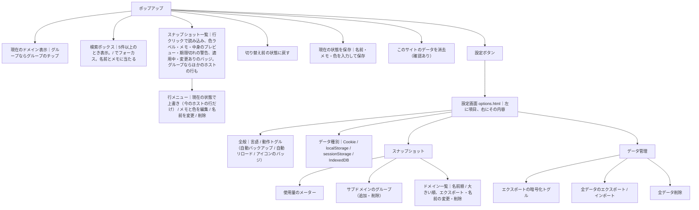

# tk3-switch-browser-data-extension

Chrome / Edge 向けブラウザ拡張機能。ドメインごとに Cookie・localStorage・sessionStorage・IndexedDB を保存し、名前付きスナップショットとして切り替えられる。

## 概要

- **対応ブラウザ**: Chrome, Edge (Chromium ベース・Manifest V3)
- **UI 起点**: 拡張機能アイコンをクリックして開くポップアップのみ（右クリックメニューは使わない）
- **設定画面**: ポップアップ内の設定ボタンまたは `options.html` で開く

## 機能要件

### データ種別（ドメインごとに管理）

| 種別           | API                                                                      |
| -------------- | ------------------------------------------------------------------------ |
| Cookie         | `chrome.cookies` API                                                     |
| localStorage   | コンテンツスクリプト（`content/content-script.js`）が `window.localStorage` を読み書きし、ポップアップとは `chrome.tabs.sendMessage` でやり取りする |
| sessionStorage | 同上（`window.sessionStorage`）                                          |
| IndexedDB      | 同上（`indexedDB` を JSON にシリアライズ / リストア）                    |

### スナップショット操作

- **保存**: 「現在の状態を保存」から名前を入力して保存する。既存の名前なら上書き確認後に上書き。各行のメニューの「現在の状態で上書き」でも上書きできる
  - 保存フォームでメモ（1行・100文字まで）と色ラベル（赤・橙・緑・青の4色。明暗の両方に値がある `--tk-*` の色だけ）を付けられる。行メニューの「メモと色を編集」で後から変える。上書きしてもメモと色は引き継ぐ。書き込むときはいつも `cleanDetails`（`lib/snapshot-summary.js`）を通し、改行は空白に、100文字を超える分は切り、一覧にない色は捨てる（インポートも同じ）
  - 色ラベルは名前の前の小さなチップ。行頭の点は「適用中・変更あり」を表すので、色ラベルには使わない
- **中身のプレビュー**: 各行にメモと `Cookie 12 · LS 4 · SS 1 · IDB 2 · 34.0 KB` のような件数と大きさを出す（`summarize`）。0件の種類は `LS 0` と出し、スナップショットにない種類は出さない。保存した Cookie に期限切れのものが1件でもあれば、控えめな警告アイコンを出す（ログインが切れているかもしれない、という知らせで、読み込みは止めない）。検索はメモにも当たる
- **読み込み**: 一覧の行をクリック（または数字キー・`Enter`）→ 現在のデータをそのスナップショットに丸ごと置き換え
  - 自動バックアップが有効なら、読み込む直前の状態をドメインごとに1件だけ残し、確認なしで読み込む（「戻す」で復元。戻すと置き換えた状態が新しいバックアップになるので、もう一度押すと元に戻る）。無効なら読み込み前に確認する
  - 自動リロードが有効なら、読み込み後にタブを再読み込みする
- **適用中の表示**: 最後に読み込み・保存したスナップショットをドメインごとに記録し、一覧に「適用中」、拡張機能アイコンのバッジに名前の先頭2文字を表示する。ポップアップを開いたときに今のデータと比べ、違えば「変更あり」を表示し、何が変わったかをツールチップに出す
  - Cookie は値まで比べる。ただしサイトが自分で書き換える Cookie は除く。読み込み後の最初のページ読み込み（60秒以内）で、Service Worker が適用した Cookie と比べて値が変わったものを「値は比べない」、増減したものを「比べない」としてドメインごとに覚える（`volatileCookies`）
  - スナップショットに保存した Cookie がすでに有効期限切れなら、その Cookie は比べない（発行し直されるか消えているのが当然のため）
  - 「変更あり」のバッジはメニューを開くボタンで、変わった Cookie ごとに「変化を無視」を選べる。値の変化なら「値は比べない」、増減なら「比べない」として `volatileCookies` に記録する
  - IndexedDB はページ側（コンテンツスクリプト）で中身のハッシュ（`lib/storage-digest.js`）だけを計算して受け渡す。スナップショット側のハッシュは保存時に `indexedDBDigest` として一緒に残す
- **名前の変更・削除**: 各行のメニューから行う（削除は確認あり）
- **サイトのデータの消去**: ポップアップの「このサイトのデータを消去」で、設定のデータ種別トグルで有効な種類（Cookie / localStorage / sessionStorage / IndexedDB）を確認後に消す。自動バックアップが有効なら消す前の状態を残し（「戻す」で復元）、適用中の記録を外し、自動リロードの設定に従って再読み込みする。IndexedDB はデータベースごと削除する（ページが接続を開いたままなら削除は予約され、再読み込みで完了する。自動リロードがオフならその旨を表示する）
  - 消す前にコンテンツスクリプトに届くか確かめ（`ping`）、届かなければ何も消さず、バックアップも上書きしない。消す順番はページの保存領域が先で Cookie が後（途中で失敗しても Cookie だけ消えた状態にしない）
  - 読み込み直後の Cookie の確認待ち（`cookieChecks`）は消去時に取り消す（空になった Cookie を「サイトが自分で消した」と覚えないため）
  - グループに入るサイトでは、グループの Cookie（`.example.com` と各サブドメインのもの）をまとめて消し、ページの保存領域は今のページの分だけ消す。グループに入らないサイトでは親ドメイン（例: `app.example.com` に対する `.example.com`）の Cookie は消えない（そのサイトのホスト権限ではその Cookie を読めないため。まとめて扱いたいときは設定画面でグループにする）
- **サイトへのアクセスの許可**: Cookie の読み書きにはサイトごとのホスト権限（`optional_host_permissions`）が要る。Chrome は権限のダイアログを出すとポップアップを閉じてしまい、保存・読み込みの途中で求めるとその操作が知らせなく失われる。そのため、Cookie が有効で権限がまだないときは、ポップアップを開いた時点で一覧の代わりに「アクセスを許可」の案内を出し、許可したらもう一度開くよう伝える。Cookie を使わない人向けに設定画面への導線も置く

### ドメイン管理

- ポップアップはアクティブタブの URL からドメインを自動検出して表示
- 設定画面でドメインの追加・削除・一覧管理が可能
- 保存データはドメインをキーとして `chrome.storage.local` に永続化

### サブドメインのグループ

- 設定画面の「スナップショット」でベースのドメイン（例: `example.com`）をグループにすると、`example.com` と `*.example.com` の Cookie（`.example.com` のドメイン Cookie を含む）をまとめて保存・消去・読み込みする。ホスト権限は `*://example.com/*` と `*://*.example.com/*` の2つ
- 追加するときは `validateNewGroup`（`lib/groups.js`）で、ドットのない名前・IP アドレス・既存のグループと重なるもの・`co.jp` のような区分（`BROAD_SECOND_LABELS`）・`github.io` のような共有ホスティング（`SHARED_HOST_SUFFIXES`）を断る。一覧は完全にはならないので、確認ダイアログでは毎回、まとめる範囲（`example.com` と `*.example.com`）と「無関係なサイトが共有するドメインには使わない」旨を出す。削除するときは `*://*.example.com/*` の権限だけ外す
- **グループは保存したデータを動かさない**。スナップショット・並び順・バックアップは保存したホストのキーのまま残り、グループを作っても消してもインポートしても書き換えない。グループはホストをまたいだ「見え方」と Cookie の範囲にすぎない（動かすと、作成・削除・インポートのたびに並び順・適用中・バックアップ・Cookie の扱いを決める必要があり、届かなくなるスナップショットや壊す操作が生まれたため）
  - ポップアップは、グループに入るホスト（`memberHosts`）のスナップショットを並べる（今のホストが先、ほかはホスト名順、それぞれ保存した順）。行はホストと名前で区別し、ほかのホストの行にはホスト名を出し、「現在の状態で上書き」は出さない（今のページのデータをほかのホストのキーに書いてしまうため）。新しく保存するのはいつも今のホスト
  - ページの保存領域（localStorage・sessionStorage・IndexedDB）は、スナップショットを保存したホストと今のホストが同じときだけ書き戻す。違えば Cookie だけ適用して、その旨を表示する
  - グループで保存したスナップショットには集めた Cookie の範囲を `cookieDomain` として残す（ないときは保存したホスト）。読み込み・比較・プレビューでは `cookieDomainFor` でその範囲と今の範囲の狭いほうに絞る。グループを作る前に保存したスナップショットはそのホストの Cookie だけを書き換え、`.example.com` やほかのサブドメインの Cookie は残す。グループを消したあとは、グループで保存したスナップショットもそのホストの範囲だけを扱う
  - Cookie を書き戻すときは `setCookiesForDomain` が範囲の外の Cookie を捨て（インポートしたデータも含めて1か所で守る）、`.` で始まる Cookie は `domain` を付けてドメイン Cookie として戻す（グループでなくても同じ）
  - 適用中の記録・`volatileCookies`・`cookieChecks` の `domain` はグループのベースをキーにする（Cookie はグループで共有なので、適用中のスナップショットはグループで1つ）

### 設定画面

- 左に項目（全般 / データ種別 / スナップショット / データ管理）、右にその項目だけを出す2列。`location.hash`（`#general` `#data-types` `#snapshots` `#data`）で開く項目を選び、リンクに `aria-current` を付ける。720px より狭いと項目は上に横並び
- **使用量のメーター**（スナップショット）: `getBytesInUse(null)` の合計と、大きい順に5ドメイン・バックアップ・その他の積み上げ棒。上限に対する割合の棒は出さない（`unlimitedStorage` で 10 MB の上限は外れているので、上限を描くと実在しない天井に見える。手を打てるのは「どのドメインが大きいか」）。50 MB 以上で「大きいとポップアップが遅くなる」と1行だけ知らせる（ポップアップを開くたびに `snapshots` を丸ごと読み、保存のたびに丸ごと書くので、大きさは容量ではなく速さに効く。50 MB は目安で `METER_ADVISORY_BYTES` の定数1つ）
- 並び順は「名前 / 大きい順」。大きい順のときは行のドラッグでの並べ替えをしない（見えていない順番を保存してしまうため）。行には色ラベル・メモ・大きさ・保存日時を出す（メモと色の編集はポップアップだけ）
- **エクスポート**: 全データ・ドメインごと・スナップショットごと。暗号化しないファイルの形はいつも `{ ドメイン: { 名前: スナップショット } }`（古い版でも読める）。グループは書き出さない
- **暗号化**: 「データ管理」のトグル（`settings.encryptExports`、既定はオフ）をオンにすると、どのエクスポートでもパスフレーズを2回（8文字以上・一致）求める。オフのときはエクスポート後に「ファイルにログイン中のセッションが入っている」と知らせ、トグルを案内する。暗号化するのはエクスポートしたファイルだけで、`chrome.storage.local` は暗号化しない（鍵をデータの横に置くなら守りにならず、ブラウザを開くたびにパスフレーズを求めるとワンクリックで切り替えられなくなるため）
  - ファイルの形（`lib/crypto.js`）は最上位が配列の JSON: `["switch-browser-data-encrypted", { "version": 1, "kdf": "PBKDF2", "hash": "SHA-256", "iterations": 600000, "salt": "base64", "iv": "base64", "data": "base64" }]`。PBKDF2-SHA-256（60万回）で鍵を作り、AES-GCM-256（salt 16バイト、IV 12バイト）で暗号化する。暗号化より前の版はインポートで配列をすべて断るので、中身をドメインとして混ぜずに失敗する
  - 読み込めるのは `iterations` が 100,000〜1,000,000 のものだけ（細工したファイルで何秒も止めないため）。パスフレーズ違いは AES-GCM の検証の失敗でわかる。復号した中身がもう一度暗号化ファイルなら断る
- **インポート**: 256 MB（`IMPORT_MAX_BYTES`）を超えるファイルは読む前に断る。`parseImport`（`lib/transfer.js`）は形が `{ ドメイン: { 名前: オブジェクト } }` でない、`__proto__` `constructor` `prototype` のキーがある、`savedAt` が日時として読めない、`cookies` がオブジェクトの配列でない、ストレージの種類がオブジェクトでない、のどれかでファイルごと断る。メモと色は `cleanDetails` で整え、文字列でない `cookieDomain` は捨てる
  - 同じドメイン・同じ名前があれば、ファイル全体で1回だけ「上書き / スキップ / 両方残す（`名前 (2)` …）/ キャンセル」を選ぶ。上書きは並び順の位置を保ち、新しい名前は末尾に足す。ドメインのキーはファイルのまま書く
- 全データ削除は `settings` と `groups` を残す（どちらも設定のため）

### UI 構成



## ディレクトリ構成

```mermaid
graph TD
  root["tk3-switch-browser-data-extension/"]
  root --> CLAUDE["CLAUDE.md"]
  root --> manifest["manifest.json｜Manifest V3"]

  root --> popup["popup/"]
  popup --> popup_html["popup.html"]
  popup --> popup_css["popup.css"]
  popup --> popup_js["popup.js"]

  root --> options["options/"]
  options --> options_html["options.html"]
  options --> options_css["options.css"]
  options --> options_js["options.js"]

  root --> background["background/"]
  background --> sw["service-worker.js｜アイコンのバッジ更新"]

  root --> content["content/"]
  content --> cs["content-script.js｜localStorage / sessionStorage / IndexedDB 操作"]

  root --> lib["lib/"]
  lib --> storage_js["storage.js｜chrome.storage.local ラッパー"]
  lib --> snapshot_js["snapshot.js｜スナップショット CRUD"]
  lib --> cookie_js["cookie-handler.js｜Cookie 保存・復元"]
  lib --> bridge_js["data-bridge.js｜データの収集・適用"]
  lib --> compare_js["data-compare.js｜スナップショットと現在のデータの比較"]
  lib --> menu_js["menu.js｜行メニュー（popover + focusgroup）"]
  lib --> rename_js["inline-rename.js｜その場での名前変更（ポップアップ・設定画面で共通）"]
  lib --> digest_js["storage-digest.js｜データのハッシュ（コンテンツスクリプトとポップアップで共通の非モジュール）"]
  lib --> volatile_js["volatile-cookies.js｜サイトが自分で書き換える Cookie の記録"]
  lib --> summary_js["snapshot-summary.js｜件数・大きさの集計、メモと色の整形"]
  lib --> groups_js["groups.js｜サブドメインのグループと Cookie の範囲"]
  lib --> transfer_js["transfer.js｜エクスポート・インポートの組み立てと検証"]
  lib --> crypto_js["crypto.js｜エクスポートファイルの暗号化（Web Crypto）"]
  lib --> etc_js["badge.js / time.js / dialog.js / i18n.js / ui.js"]
  lib --> tk_base["tk-base.css｜tk3 apps の共通デザインの土台（手を加えない）"]

  root --> icons["icons/"]
  icons --> isvg["icon.svg｜ヘッダー・favicon"]
  icons --> i16["icon16.png"]
  icons --> i32["icon32.png"]
  icons --> i48["icon48.png"]
  icons --> i128["icon128.png"]

  root --> tests["tests/"]
  tests --> unit["unit/｜Vitest ユニットテスト"]
  tests --> e2e["e2e/｜Playwright E2Eテスト"]
  tests --> support["support/｜chromeモック・テストヘルパー"]
  root --> pkg["package.json｜devDependencies（テストツールのみ）"]
```



## manifest.json の主要設定

```json
{
  "manifest_version": 3,
  "permissions": ["cookies", "storage", "unlimitedStorage", "tabs"],
  "host_permissions": ["<all_urls>"],
  "background": { "service_worker": "background/service-worker.js", "type": "module" },
  "commands": { "_execute_action": { "suggested_key": { "default": "Alt+Shift+S" } } },
  "action": { "default_popup": "popup/popup.html" },
  "options_page": "options/options.html",
  "content_scripts": [
    {
      "matches": ["<all_urls>"],
      "js": ["content/content-script.js"],
      "run_at": "document_idle"
    }
  ]
}
```

## データ構造（chrome.storage.local）

```js
// キー: "snapshots"
{
  "snapshots": {
    "example.com": {
      "スナップショット名": {
        "savedAt": "ISO 8601 timestamp",
        "memo": "1行・100文字まで（任意）",
        "color": "red | amber | green | blue（任意）",
        // 集めた Cookie の範囲（グループで保存したときだけ。ないときはこのキーのホスト）
        "cookieDomain": "example.com",
        "cookies": [ /* CookieDetails[] */ ],
        "localStorage": { "key": "value", ... },
        "sessionStorage": { "key": "value", ... },
        "indexedDB": { "dbName": { "storeName": [ /* records */ ] } }
      }
    }
  },
  "snapshotOrder": { "example.com": ["スナップショット名", ...] },
  // グループのベースでは、どのホストのスナップショットかも残す { host, name }
  "activeSnapshots": { "example.org": "スナップショット名", "example.com": { "host": "app.example.com", "name": "スナップショット名" } },
  // サブドメインのグループ（ベースのドメイン）。全データ削除でも消さない
  "groups": ["example.com"],
  // サイトが自分で書き換える Cookie（グループならベースがキー）。"value": 有無だけ比べる / "any": 比べない
  "volatileCookies": { "example.com": { "example.com|/|名前": "value" } },
  // 読み込み直後の Cookie の確認待ち（タブ ID ごと、60秒で期限切れ）。origins は確認に要る権限、
  // cookieDomain は今の Cookie を読む範囲。どちらもない古い記録は domain のホストだけで確かめる
  "cookieChecks": { "123": { "domain": "example.com", "cookies": [], "origins": ["*://example.com/*", "*://*.example.com/*"], "cookieDomain": "example.com", "until": 0 } },
  // 読み込み直前の状態。ドメインごとに1件。スナップショット一覧・エクスポートには含めない
  "backups": {
    "example.com": { "savedAt": "...", "activeName": "スナップショット名 | null", "cookies": [], ... }
  },
  // 保存されていないキーは既定値（encryptExports だけ false、ほかは true）で補う。トグルを変えたらその場で保存する
  "settings": {
    "enabledTypes": { "cookies": true, "localStorage": true, "sessionStorage": true, "indexedDB": true },
    "autoBackup": true,
    "autoReload": true,
    "showBadge": true,
    "encryptExports": false
  }
}
```

## 技術方針

- **フレームワーク**: バニラ JS（TypeScript は使わない）。依存ライブラリなし（`lib/` `popup/` `options/` `background/` `content/` などランタイムコードに限る。テストツールは devDependencies として許可。「自動テスト」節を参照）
- **スタイル**: CSS のみ（外部 CSS フレームワーク不使用）。tk3 apps の共通デザインの土台 `lib/tk-base.css` を各画面の CSS より先に読み込み、色は `--tk-*` の変数を使う（直に色の値を書かない）。明暗は端末の設定（`prefers-color-scheme`）に従う。アクセントは `--tk-blue`。入力欄・セレクトの枠は `--tk-line-strong`（地とのコントラスト 3:1 以上）、区切り線やパネルの枠は `--tk-line`。`lib/tk-base.css` は手を加えずに写したもので、直すときは元（tk3-biz-html の `design/tk3-apps/tk-base.css`）を直して写し直す
  - tk3.biz へのリンクのフッター（`.tk-footer`）は設定画面だけに置く。ポップアップは小さいので、「各画面の下にフッター」の決まりの例外にしている
- **モジュール**: ES Modules（`type="module"`）
- **非同期**: すべて `async/await` で統一
- **エラー処理**: ユーザー操作起点の処理にのみ try/catch を置く。内部ライブラリは例外を上位に伝播させる
- **コメント**: 非自明な理由がある箇所のみ記述。コードの説明コメントは書かない
- **IndexedDB シリアライズ**: `IDBObjectStore` を全件 `getAll()` で読み出し JSON 化。復元時は、バージョンと store の構成（`keyPath` `autoIncrement`）が同じなら既存 store をクリアして `add()` で再投入する（ページが接続を開いたままでも待たされない）。構成が違うときだけデータベースを作り直し、ページが開いたままで削除できなければ（`blockedWaitMs` 待っても）エラーにする

## 実装時の注意点

- 権限は使うものだけを宣言する（使っていない権限は Chrome Web Store の審査で指摘されることがある）。`scripting` と `activeTab` は使っていないので宣言しない。localStorage などはマニフェストで宣言したコンテンツスクリプトが扱う
- sessionStorage はタブをまたいで取得できないため、コンテンツスクリプト経由でアクティブタブから取得する
- Cookie の `httpOnly` フラグが付いたものは JS からは読めないが `chrome.cookies` API なら取得可能
- IndexedDB の復元時はスキーマ（`keyPath`, `autoIncrement`）も保存しておく必要がある
- `chrome.storage.local` の容量上限は約 10 MB だが、`unlimitedStorage` 権限で上限を外している（ユーザーへの追加の許可確認は出ない）。それでもバックアップを残せなかったときは、読み込みは続けてその旨を表示する

## 開発・テスト

```powershell
# Chrome に読み込む
# chrome://extensions/ → デベロッパーモード ON → 「パッケージ化されていない拡張機能を読み込む」
# → tk3-switch-browser-data-extension を選択

# Edge に読み込む
# edge://extensions/ → 同様の手順
```

- 手動テストは Chrome の DevTools → Application タブで各ストレージの状態を確認しながら行う

### 自動テスト

- **ユニットテスト**: [Vitest](https://vitest.dev/)。`tests/unit/` に配置。対象は `lib/` 配下のロジックに加え、`popup/popup.js` `options/options.js`（jsdomにHTMLを読み込み、DOM操作込みで検証）。`chrome.*` API は `tests/support/chrome-mock.js` のインメモリモックを使う。`var` グローバルとして書かれた非モジュールスクリプト（`lib/web-storage-handlers.js` `lib/indexeddb-handler.js` `lib/storage-digest.js` `content/content-script.js`）は `import` できないため、`tests/support/load-script.js` でソースを読み込み `Function` コンストラクタでスコープを分離しつつ実行し、生成されたハンドラを取り出してテストする
- **E2Eテスト**: [Playwright](https://playwright.dev/)。`launchPersistentContext` に `--load-extension` を渡して本拡張機能を実際の Chromium に読み込み、ポップアップ・設定画面の操作を検証する。テストページのポートは `tests/e2e/test-page.js` に集約されており、`TK3_E2E_PORT` で上書きできる
  - Cookie の読み取りに要るホスト権限は実行時に Chrome のダイアログで求めるが、Playwright はこれを操作できない。Cookie を扱うテスト（`tests/e2e/cookies.spec.js`）は `test.use({ grantHostPermissions: true })` で、manifest にホスト権限を足した拡張機能のコピーを一時フォルダに作って読み込む。テストページの `/cookies/` は毎回値の変わる `csrf` と、`/cookies/login?user=名前` でだけ変わる `sid` を返す
  - グループのテスト（`tests/e2e/groups.spec.js`）は `--host-resolver-rules` で `example.test` と `*.example.test` をテストサーバーに向ける（`localhost` ではドメイン Cookie が当てにならないため）。`/group/login?user=名前` は `Domain=example.test` の `gsid` を返す
- **実装中に手元で流すテストは、変更に関係するものだけにする**（例: `npx vitest run tests/unit/popup.test.js`、`npx playwright test tests/e2e/popup.spec.js`）。全テストは CI（GitHub Actions）で流すので、手元で `npm test` や `npm run test:e2e` を丸ごと流さなくてよい
- テスト用の依存関係（Vitest, Playwright, jsdom, fake-indexeddb など）は devDependencies としてのみ追加可。拡張機能本体のランタイムコードに外部ライブラリを追加することは引き続き禁止

```powershell
npm install                      # 初回のみ。devDependencies をインストール
npm test                         # ユニットテスト (Vitest)
npx playwright install chromium  # 初回のみ。E2E 用ブラウザを取得
npm run test:e2e                 # E2Eテスト (Playwright)
```

## コミット運用ルール

- コミットを作成する前に `manifest.json` の `version` を patch バージョンで 0.0.1 加算する（例: `1.0.1` → `1.0.2`）
- バージョン加算とコミット対象の変更は同一コミットに含める
