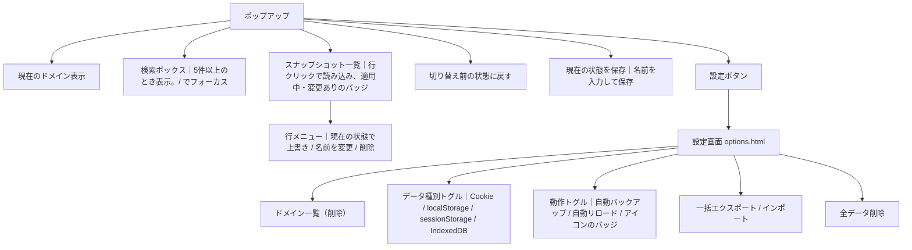

# tk3-switch-browser-data-extension

Chrome / Edge 向けブラウザ拡張機能。ドメインごとに Cookie・localStorage・sessionStorage・IndexedDB を保存し、名前付きスナップショットとして切り替えられる。

## 概要

- **対応ブラウザ**: Chrome, Edge (Chromium ベース・Manifest V3)
- **UI 起点**: 拡張機能アイコンをクリックして開くポップアップのみ（右クリックメニューは使わない）
- **設定画面**: ポップアップ内の設定ボタンまたは `options.html` で開く

## 機能要件

### データ種別（ドメインごとに管理）

| 種別           | API                                                                      |
| -------------- | ------------------------------------------------------------------------ |
| Cookie         | `chrome.cookies` API                                                     |
| localStorage   | `chrome.scripting.executeScript` 経由で `window.localStorage` を読み書き |
| sessionStorage | 同上（`window.sessionStorage`）                                          |
| IndexedDB      | 同上（`indexedDB` を JSON にシリアライズ / リストア）                    |

### スナップショット操作

- **保存**: 「現在の状態を保存」から名前を入力して保存する。既存の名前なら上書き確認後に上書き。各行のメニューの「現在の状態で上書き」でも上書きできる
- **読み込み**: 一覧の行をクリック（または数字キー・`Enter`）→ 現在のデータをそのスナップショットに丸ごと置き換え
  - 自動バックアップが有効なら、読み込む直前の状態をドメインごとに1件だけ残し、確認なしで読み込む（「戻す」で復元。戻すと置き換えた状態が新しいバックアップになるので、もう一度押すと元に戻る）。無効なら読み込み前に確認する
  - 自動リロードが有効なら、読み込み後にタブを再読み込みする
- **適用中の表示**: 最後に読み込み・保存したスナップショットをドメインごとに記録し、一覧に「適用中」、拡張機能アイコンのバッジに名前の先頭2文字を表示する。ポップアップを開いたときに今のデータと比べ、違えば「変更あり」を表示し、何が変わったかをツールチップに出す
  - Cookie は値まで比べる。ただしサイトが自分で書き換える Cookie は除く。読み込み後の最初のページ読み込み（60秒以内）で、Service Worker が適用した Cookie と比べて値が変わったものを「値は比べない」、増減したものを「比べない」としてドメインごとに覚える（`volatileCookies`）
  - IndexedDB はページ側（コンテンツスクリプト）で中身のハッシュ（`lib/storage-digest.js`）だけを計算して受け渡す。スナップショット側のハッシュは保存時に `indexedDBDigest` として一緒に残す
- **名前の変更・削除**: 各行のメニューから行う（削除は確認あり）

### ドメイン管理

- ポップアップはアクティブタブの URL からドメインを自動検出して表示
- 設定画面でドメインの追加・削除・一覧管理が可能
- 保存データはドメインをキーとして `chrome.storage.local` に永続化

### UI 構成



## ディレクトリ構成

```mermaid
graph TD
  root["tk3-switch-browser-data-extension/"]
  root --> CLAUDE["CLAUDE.md"]
  root --> manifest["manifest.json｜Manifest V3"]

  root --> popup["popup/"]
  popup --> popup_html["popup.html"]
  popup --> popup_css["popup.css"]
  popup --> popup_js["popup.js"]

  root --> options["options/"]
  options --> options_html["options.html"]
  options --> options_css["options.css"]
  options --> options_js["options.js"]

  root --> background["background/"]
  background --> sw["service-worker.js｜アイコンのバッジ更新"]

  root --> content["content/"]
  content --> cs["content-script.js｜localStorage / sessionStorage / IndexedDB 操作"]

  root --> lib["lib/"]
  lib --> storage_js["storage.js｜chrome.storage.local ラッパー"]
  lib --> snapshot_js["snapshot.js｜スナップショット CRUD"]
  lib --> cookie_js["cookie-handler.js｜Cookie 保存・復元"]
  lib --> bridge_js["data-bridge.js｜データの収集・適用"]
  lib --> compare_js["data-compare.js｜スナップショットと現在のデータの比較"]
  lib --> menu_js["menu.js｜行メニュー（popover + focusgroup）"]
  lib --> rename_js["inline-rename.js｜その場での名前変更（ポップアップ・設定画面で共通）"]
  lib --> digest_js["storage-digest.js｜データのハッシュ（コンテンツスクリプトとポップアップで共通の非モジュール）"]
  lib --> volatile_js["volatile-cookies.js｜サイトが自分で書き換える Cookie の記録"]
  lib --> etc_js["badge.js / time.js / dialog.js / i18n.js / ui.js"]
  lib --> tk_base["tk-base.css｜tk3 apps の共通デザインの土台（手を加えない）"]

  root --> icons["icons/"]
  icons --> isvg["icon.svg｜ヘッダー・favicon"]
  icons --> i16["icon16.png"]
  icons --> i32["icon32.png"]
  icons --> i48["icon48.png"]
  icons --> i128["icon128.png"]

  root --> tests["tests/"]
  tests --> unit["unit/｜Vitest ユニットテスト"]
  tests --> e2e["e2e/｜Playwright E2Eテスト"]
  tests --> support["support/｜chromeモック・テストヘルパー"]
  root --> pkg["package.json｜devDependencies（テストツールのみ）"]
```



## manifest.json の主要設定

```json
{
  "manifest_version": 3,
  "permissions": ["cookies", "storage", "scripting", "activeTab", "tabs"],
  "host_permissions": ["<all_urls>"],
  "background": { "service_worker": "background/service-worker.js", "type": "module" },
  "commands": { "_execute_action": { "suggested_key": { "default": "Alt+Shift+S" } } },
  "action": { "default_popup": "popup/popup.html" },
  "options_page": "options/options.html",
  "content_scripts": [
    {
      "matches": ["<all_urls>"],
      "js": ["content/content-script.js"],
      "run_at": "document_idle"
    }
  ]
}
```

## データ構造（chrome.storage.local）

```js
// キー: "snapshots"
{
  "snapshots": {
    "example.com": {
      "スナップショット名": {
        "savedAt": "ISO 8601 timestamp",
        "cookies": [ /* CookieDetails[] */ ],
        "localStorage": { "key": "value", ... },
        "sessionStorage": { "key": "value", ... },
        "indexedDB": { "dbName": { "storeName": [ /* records */ ] } }
      }
    }
  },
  "snapshotOrder": { "example.com": ["スナップショット名", ...] },
  "activeSnapshots": { "example.com": "スナップショット名" },
  // サイトが自分で書き換える Cookie。"value": 有無だけ比べる / "any": 比べない
  "volatileCookies": { "example.com": { "example.com|/|名前": "value" } },
  // 読み込み直後の Cookie の確認待ち（タブ ID ごと、60秒で期限切れ）
  "cookieChecks": { "123": { "domain": "example.com", "cookies": [], "until": 0 } },
  // 読み込み直前の状態。ドメインごとに1件。スナップショット一覧・エクスポートには含めない
  "backups": {
    "example.com": { "savedAt": "...", "activeName": "スナップショット名 | null", "cookies": [], ... }
  },
  // 保存されていないキーは既定値（すべて true）で補う。トグルを変えたらその場で保存する
  "settings": {
    "enabledTypes": { "cookies": true, "localStorage": true, "sessionStorage": true, "indexedDB": true },
    "autoBackup": true,
    "autoReload": true,
    "showBadge": true
  }
}
```

## 技術方針

- **フレームワーク**: バニラ JS（TypeScript は使わない）。依存ライブラリなし（`lib/` `popup/` `options/` `background/` `content/` などランタイムコードに限る。テストツールは devDependencies として許可。「自動テスト」節を参照）
- **スタイル**: CSS のみ（外部 CSS フレームワーク不使用）。tk3 apps の共通デザインの土台 `lib/tk-base.css` を各画面の CSS より先に読み込み、色は `--tk-*` の変数を使う（直に色の値を書かない）。明暗は端末の設定（`prefers-color-scheme`）に従う。アクセントは `--tk-blue`。入力欄・セレクトの枠は `--tk-line-strong`（地とのコントラスト 3:1 以上）、区切り線やパネルの枠は `--tk-line`。`lib/tk-base.css` は手を加えずに写したもので、直すときは元（tk3-biz-html の `design/tk3-apps/tk-base.css`）を直して写し直す
  - tk3.biz へのリンクのフッター（`.tk-footer`）は設定画面だけに置く。ポップアップは小さいので、「各画面の下にフッター」の決まりの例外にしている
- **モジュール**: ES Modules（`type="module"`）
- **非同期**: すべて `async/await` で統一
- **エラー処理**: ユーザー操作起点の処理にのみ try/catch を置く。内部ライブラリは例外を上位に伝播させる
- **コメント**: 非自明な理由がある箇所のみ記述。コードの説明コメントは書かない
- **IndexedDB シリアライズ**: `IDBObjectStore` を全件 `getAll()` で読み出し JSON 化。復元時は既存 store をクリアして `add()` で再投入

## 実装時の注意点

- `chrome.scripting.executeScript` は `activeTab` か `host_permissions` が必要。`func` オプションで関数を渡す形式を使う
- sessionStorage はタブをまたいで取得できないため、コンテンツスクリプト経由でアクティブタブから取得する
- Cookie の `httpOnly` フラグが付いたものは JS からは読めないが `chrome.cookies` API なら取得可能
- IndexedDB の復元時はスキーマ（`keyPath`, `autoIncrement`）も保存しておく必要がある
- `chrome.storage.local` の容量上限は約 10 MB。大量データは警告を表示する

## 開発・テスト

```powershell
# Chrome に読み込む
# chrome://extensions/ → デベロッパーモード ON → 「パッケージ化されていない拡張機能を読み込む」
# → tk3-switch-browser-data-extension を選択

# Edge に読み込む
# edge://extensions/ → 同様の手順
```

- 手動テストは Chrome の DevTools → Application タブで各ストレージの状態を確認しながら行う

### 自動テスト

- **ユニットテスト**: [Vitest](https://vitest.dev/)。`tests/unit/` に配置。対象は `lib/` 配下のロジックに加え、`popup/popup.js` `options/options.js`（jsdomにHTMLを読み込み、DOM操作込みで検証）。`chrome.*` API は `tests/support/chrome-mock.js` のインメモリモックを使う。`var` グローバルとして書かれた非モジュールスクリプト（`lib/web-storage-handlers.js` `lib/indexeddb-handler.js` `lib/storage-digest.js` `content/content-script.js`）は `import` できないため、`tests/support/load-script.js` でソースを読み込み `Function` コンストラクタでスコープを分離しつつ実行し、生成されたハンドラを取り出してテストする
- **E2Eテスト**: [Playwright](https://playwright.dev/)。`launchPersistentContext` に `--load-extension` を渡して本拡張機能を実際の Chromium に読み込み、ポップアップ・設定画面の操作を検証する。テストページのポートは `tests/e2e/test-page.js` に集約されており、`TK3_E2E_PORT` で上書きできる
  - Cookie の読み取りに要るホスト権限は実行時に Chrome のダイアログで求めるが、Playwright はこれを操作できない。Cookie を扱うテスト（`tests/e2e/cookies.spec.js`）は `test.use({ grantHostPermissions: true })` で、manifest にホスト権限を足した拡張機能のコピーを一時フォルダに作って読み込む。テストページの `/cookies/` は毎回値の変わる `csrf` と、`/cookies/login?user=名前` でだけ変わる `sid` を返す
- テスト用の依存関係（Vitest, Playwright, jsdom, fake-indexeddb など）は devDependencies としてのみ追加可。拡張機能本体のランタイムコードに外部ライブラリを追加することは引き続き禁止

```powershell
npm install                      # 初回のみ。devDependencies をインストール
npm test                         # ユニットテスト (Vitest)
npx playwright install chromium  # 初回のみ。E2E 用ブラウザを取得
npm run test:e2e                 # E2Eテスト (Playwright)
```

## コミット運用ルール

- コミットを作成する前に `manifest.json` の `version` を patch バージョンで 0.0.1 加算する（例: `1.0.1` → `1.0.2`）
- バージョン加算とコミット対象の変更は同一コミットに含める
